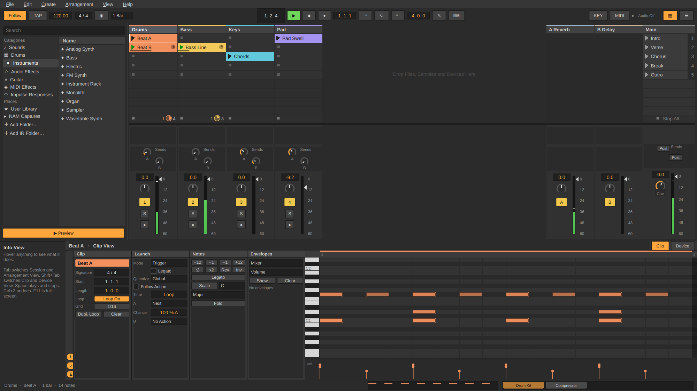
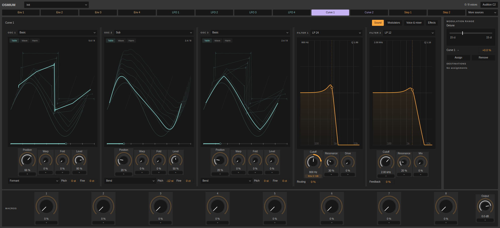
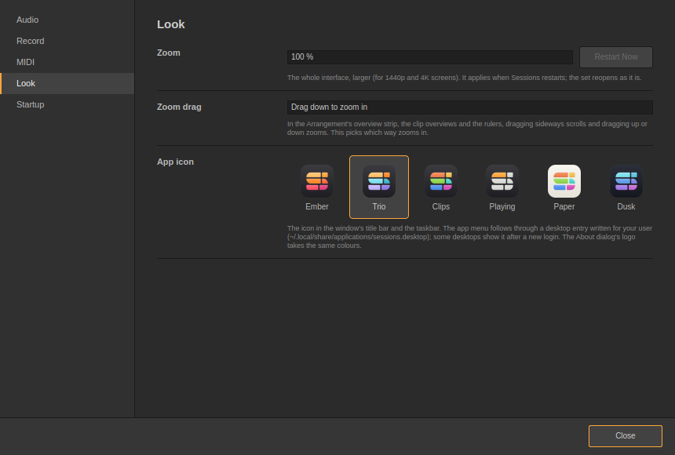
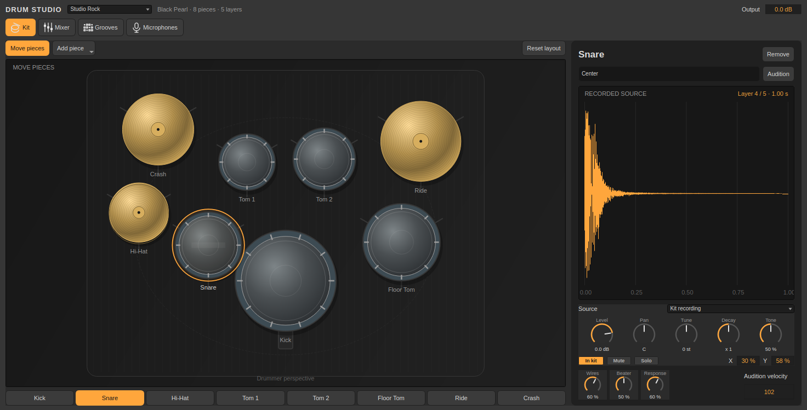

<p align="center">
  <picture>
    <source media="(prefers-color-scheme: dark)" srcset="assets/logo/sessions-logo-light.svg">
    
  </picture>
</p>

Build ideas quickly in the Session grid, launch clips and scenes in real time, then shape them into complete tracks in the Arrangement timeline. Work seamlessly with MIDI and audio tracks, instruments, effects, and integrated Neural Amp Modeler support, all within a streamlined workflow built to keep the focus on making music.

A clip-based music sequencer in C++17 / Qt 6, built around two views: a Session grid for launching clips, an Arrangement timeline with automation, MIDI and audio tracks, a note editor with scales, warped audio clips, instruments (including a Sampler) and effects, and a mixer with return tracks. It plays through PipeWire / PulseAudio, you can play and record with a MIDI keyboard or the computer keyboard, map controllers and keys to anything (MIDI Map / Key Map), export the song to WAV, and your work is saved as `.sessions` sets. See `handoff.md` for status and the roadmap.



## Osmium

Load **Instruments → Osmium**, then click **Expand**. Monolith is still available with its original panel and sound engine behavior.

- **48 morphing wavetables** (0.39): the original eight plus Analog, Spectral, Vocal, Metal, Digital, Bass and Organic families. Open an oscillator's table selector to search names/families and preview waveforms. Drag the large **Table** display to scan its eight frames; **Wave** shows the shaped cycle and **Harm** its harmonic content.
- **Eight oscillator Warp modes**: Bend, Formant, Sync, Phase, Fold, Asym, Steps and **Cross FM**. Cross FM uses the next oscillator's table, position and pitch, even when that oscillator is silent in the mix. A separate **Fold** control on each oscillator adds antialiased wavefolding and accepts modulation.
- Select an envelope, LFO, curve or stepper, then click a knob's **+** slot, or drag the source onto it. Drag the **accent outer ring** to set the range; drag the knob's centre or inner ring to set its base. The faded outer track previews the full range, with a clear gap between rings. Position and cutoff retain larger dials, ordinary controls are compact, and macros stay large (0.39). Shift makes fine adjustments. The range panel shows both ends in the parameter's units and accepts an exact signed percentage.
- Shape the four envelopes with timing/level nodes and separate attack, decay and release bend diamonds. Loop repeats attack and decay while held.
- Edit both phrase curves with up to **257 nodes**, **1/256** time grids, optional level snap, **1–8× zoom/pan**, exact **X / Y / Bend** fields, and Curve / Smooth / Hold segments (0.31.1). Freehand follows the chosen grid. Shift-click or drag a box to select nodes together; Ctrl-drag locks an axis; arrows nudge and Shift makes fine nudges. Double-click adds a node; Delete removes selected interior nodes. Alt bypasses snap. [Editing guide](docs/osmium-editing.md).
- Four LFOs, two 16-step sequencers, eight macros, dual filters, unison, sub/noise/modulation oscillators, drive and effects share the same modulation system. **Voice & mixer** and **Effects** expose the remaining controls. Editing their modulation rings keeps the selected page open.
- **132 factory presets**: 24 new **Gesture Bass** patches (0.43) use two independent, asymmetric one-shot contours over a sustained bass core, without periodic LFO/stepper routes or looping envelopes. They join 48 Wavefront sounds, the original 40 and 20 Dubstep / DnB wobble basses. [Gesture Bass guide](docs/osmium-gesture-bass.md) · [Wavefront guide](docs/osmium-wavefront-presets.md).
- The **compact panel** has a searchable preset selector and **previous/next** buttons. Navigation wraps through the bank, skips separators and loads each sound in one undo step. Both panel sizes follow selection, undo and redo.
- **40 Drum & Bass presets** (0.29): eight each of pads, leads/plucks, subs, reeses and wobbles, alongside the original starting patches. Type into the patch selector to search, or search **Osmium** under **Browser → Sounds**. Every preset has shaped envelopes, saved modulation/curves and eight performance macros: **Tone, Warp, Drive, Width, Space, Echo, Body, Air**. Names and modifications survive set/preset saving; loading a new sound is one undo step. See the [preset guide](docs/osmium-dnb-presets.md).
- **20 wobble basses** (0.44): ten **Dubstep** (voiced at 140 BPM) and ten **DnB Bass** (174 BPM), listed after a separator in the patch selector. Each Curve 1 is a one-, two- or four-bar phrase that changes rate as it plays (quarters, eighths, triplets, sixteenths, 1/32 rolls), so a held note already varies. Automate **Curve1 Rate** (the curve's **Length**) to stretch or speed up the whole phrase. Play around F1: the sub sits an octave below and the filters follow the keyboard. See the [wobble bass guide](docs/osmium-wobble-basses.md).
- The editor expands inside Sessions’ device pane (0.30), with **Sound**, **Modulators**, **Voice & mixer** and **Effects** pages. Drag the divider for more space; **Device chain ▾** collapses it. Undo and panel rebuilds preserve the editor. Switching tracks hides it; returning restores it. **Audition C2** plays through the track.



Focused checks and reproducible editor captures:

```sh
QT_QPA_PLATFORM=offscreen ./build/sessions_osmium docs/screenshots/osmium
QT_QPA_PLATFORM=offscreen ./build/sessions_drum_studio /tmp/drum-studio # audits kits/grooves; exports MIDI/native clips, audio and captures
./build/sessions_osmium_bank /tmp/osmium-bank  # audits all 132 presets; exports presets, audition WAV, guides and levels
QT_QPA_PLATFORM=offscreen ./build/sessions_osmium_ui # table browsing, scan gestures and responsive layouts
./build/sessions_wavetable_bank             # legacy samples, band limits and morphing audit
./build/sessions_osmium_dsp                 # shaping, FM, persistence and callback allocation checks
```

## Autosave and recovery · 0.42

Changed and untitled sets receive a recovery snapshot every two minutes, retaining three versions. Startup and **File → Recover Set…** offer interrupted sessions as unsaved copies. Background manual saving keeps later edits dirty; ten rolling saved versions live under the project's **Backups** folder. **Preferences → Startup** controls intervals and retention. In-progress MIDI/audio takes are included up to the completed checkpoint. [Recovery and backup guide](docs/recovery.md).

## Studio additions · 0.41

- Six downloaded collections in **Browser → Drums** and Drum Studio's **Library** selector; the separate content installer includes 6,061 unmodified recordings with velocity layers, round robins and recorded mics where available.
- **NAM** adds Bass, Mid, Treble and Presence, flat in existing sets.
- **Stereo Width** adds M/S widening, mono bass, mono-source spreading, monitoring and measured meters.
- **Drum Rack → Waveform** opens a sliding stereo waveform shelf with zoom, pan, Fit, audition and sample loading.

[Installation, controls, source credits and scope](docs/studio-expansion.md).

## Build (Linux)

```sh
sudo apt install build-essential cmake qt6-base-dev qt6-svg-dev libpulse-dev libasound2-dev   # Debian / Ubuntu / Zorin
cmake -S . -B build -DCMAKE_BUILD_TYPE=Release
cmake --build build -j
./build/sessions
```

On older Ubuntu releases the SVG package is called `libqt6svg6-dev`. Without `libpulse-dev` the app still builds, but it plays no sound; without `libasound2-dev` it has no MIDI input. WAV and AIFF files load out of the box; FLAC, Ogg Vorbis, Opus and MP3 load when `libsndfile1` is installed (it usually is, and the .deb recommends it). It's loaded at run time, so building doesn't need it.

## Installing: the .deb

Every build that changes the app also writes a package to `dist/`, named `sessions_<version>+<timestamp>_amd64.deb` (only the newest one is kept). The timestamp means each new package counts as an upgrade. Install it from the project folder with:

```sh
sudo apt install ./dist/sessions_*.deb
```

Sessions then shows up in the app menu, and double-clicking a `.sessions` file in the file manager opens it in Sessions. To skip packaging, configure with `-DSESSIONS_BUILD_DEB=OFF`. To put your own name in the package, use `-DSESSIONS_DEB_MAINTAINER="Name <email>"`.

## Artwork

`assets/logo/` holds the logo (`sessions-logo.svg`, charcoal on a transparent background; `sessions-logo-light.svg` for dark pages; `sessions-mark.svg`, the S alone). The app icon is `assets/icon/sessions.svg` (the S in colour on a charcoal tile) with its rendered PNGs beside it; `assets/icon/variants/` has all six colour treatments, and **Preferences → Look → App icon** lets you pick one (0.25): the window, the taskbar, the app menu (through a desktop entry written for your user) and the About logo follow.



## Shortcuts

| Key | Action |
| --- | --- |
| Ctrl+N / Ctrl+O | New set / open a set |
| Ctrl+S / Ctrl+Shift+S | Save / Save As |
| Ctrl+Shift+R | Export Audio |
| Tab / Shift+Tab | Session ↔ Arrangement / Clip View ↔ Device View |
| Tab while dragging a Session clip | Carry the clip into the Arrangement: drop it on a lane of its kind for a copy at the snapped beat (Alt: off the grid); Tab again brings it back; Esc lets go |
| Ctrl+Alt+B | Show / hide the browser |
| Ctrl+M / Ctrl+K | MIDI Map / Key Map mode (Esc leaves) |
| Ctrl+, | Preferences (0.25: a sidebar of categories, pages of settings) |
| Ctrl+/ | Keyboard shortcuts |
| F11 | Full screen |
| 1 2 3 4 5 6 7 8 9 0 | Launch Session scenes 1–10 (number row; typing and custom Key Maps take priority) |
| Space | Play from the start marker / stop (click an Arrangement clip to start there) |
| Shift+Space | Play on from where it stopped |
| Ctrl+Z / Ctrl+Shift+Z (or Ctrl+Y) | Undo / redo |
| Ctrl+X / Ctrl+C / Ctrl+V | Cut / copy / paste a clip (into a slot, or at the insert marker), or the selected part of an Arrangement clip (0.21: it pastes as a clip of its own that still holds the whole sample) |
| Ctrl+D | Duplicate notes, clip, scene, track or time selection |
| Ctrl+drag an Arrangement clip (or a selected part of one) | A copy lands where you drop it; the original stays |
| Ctrl+R | Rename the selected track, scene or clip |
| Delete | Delete the selected notes, clip, scene, track, breakpoint or time selection |
| Ctrl+T / Ctrl+Shift+T / Ctrl+Alt+T | Insert MIDI track / audio track / return track |
| Ctrl+G / Ctrl+Shift+G | Group the selected tracks / ungroup (Ctrl+click or Shift+click track titles to select several) |
| Ctrl+I / Ctrl+Shift+I | Insert scene (or time, in the Arrangement) / Capture and Insert Scene |
| Ctrl+L / Ctrl+E / Ctrl+J | Loop selection / split / consolidate (Arrangement) |
| A | Automation mode (Arrangement) |
| M | Computer MIDI keyboard: A W S E D F T G Y H U J K O L P play notes, Z / X octave, C / V velocity |
| B | Draw Mode |
| Ctrl+1 / Ctrl+2 | Grid finer / coarser |
| Ctrl+A | Select all notes |
| Arrows | Move notes (Shift+Up/Down = octave, Shift+Left/Right = length) |
| In the Device View | Click a device's title to select it (Ctrl / Shift+click for several): Delete, Ctrl+D, Ctrl+C / Ctrl+V, Ctrl+G (into a rack), Ctrl+Shift+G (ungroup) |
| In the Takes view | Drag across a take: use that stretch; click: one grid step; double-click: the whole take; Alt: off the grid; wheel: more takes |

Clip slots keep the same size however big the window is; drag the divider between two Session columns to make one wider (double-click it for the default). In the Arrangement, the strip at the top is an overview of the whole song: drag it sideways to scroll the timeline, up or down to zoom (**Preferences → Look → Zoom drag** picks whether dragging down or up zooms in; the beat rulers and the clip overviews zoom the same way), click it to go there. Every grid shades every second beat a little lighter (0.21), so the beats read at a glance; zoomed out it's every second bar, then every second four bars, so a long clip stays calm. Each track header has volume, pan and send fields you can drag (double-click resets). Every value field drags the same way, and the drag is endless (0.28): at the top or bottom of the screen the pointer jumps to the other edge and keeps going. Double-click a field to type a value as it reads (35 for 35 %). **Follow** in the control bar and Arrangement header controls the timeline. Clip View has its own independent **Follow** button for the waveform/piano roll. Each preserves zoom and scrolls when playback leaves the view; turn it off to hold the view. Loop braces and start/end flags use matching neutral colors across editors. Arrangement returns and Master stay at the bottom, with unused space above and separate scrolling for longer track lists (0.38). The control bar (tidied in 0.35) keeps everything on one 24 px line, with SVG icons that follow the theme. Right-click tracks, scenes, clips, locators and lanes for more. Everything else is in the Info View (bottom left) when you hover it. The Clip View's pane is as high as its boxes at a first start and can't be squashed below them (0.37); drag its divider for a taller editor and the height stays while you pick clips. **View → Zoom** scales the whole interface (handy on 1440p and 4K screens); it applies at once (0.26): Sessions reloads with your set as it was, unsaved changes included and the window where it was. **View → Theme** switches themes at once, no restart, and remembers your choice: **Dark** (the original), **Mid** and **Light**, then **Midnight**, **Graphite**, **Ember**, **Forest**, **Plum**, **Slate**, **Paper**, **Sky** and **High Contrast** (0.19), and any you make with **Customize…**: start from any theme, tint the greys to a hue, set the contrast and the accent colour, or pick any single colour, all live; **Save** keeps it as yours (a `.sessionstheme` file in `~/.local/share/Sessions/Sessions/Themes`) and lists it in the menu.

**The overview bar** (0.19, reworked in 0.21): the strip along the bottom of the window shows what's selected, the selected clip in miniature (its notes or its waveform, with the playhead while it plays and an outline around what the Clip View's editor shows) and the selected track's devices in miniature: a scaled-down picture of each device panel, in chain order. Drag the clip overview sideways to scroll the editor, up or down to zoom it; click it to open the Clip View. Drag the device chain sideways to scroll along a long chain; click a device to open the Device View with it selected. The same clip overview sits right over the Clip View's editor (as wide as the editor, under the Arrangement's time ruler) and works the same way; a click there centres the editor on that beat. Neither view scrolls before 1.1.1 or zooms out past the whole clip, and the wheel with Ctrl zooms around the pointer.

**Clip / Device** (0.21): the two tabs stand on their side between the Info View and the detail pane, so the header keeps its width for the clip overview. Arrangement Record goes out when the song stops.

**The Clip View** (0.38.2) keeps timing, loop and library saving in one persistent column. Beside it, **Sample / Notes**, **Launch** and **Envelopes** tabs share one page. Its 437 px inspector uses readable fields and leaves the remaining width to the waveform or piano roll; the selected tab is remembered. Returning to Sample / Notes restores that editor from Envelopes or Takes.

**Panes** (0.17): drag the divider right of the browser to make it wider. The Device View's pane is exactly as high as the devices need and its divider is fixed; the Clip View's pane (the piano roll) can be dragged as high as you like, and comes back at that height.

**Played keys** light up on the piano roll's keyboard in the record red, with a faint band along their rows, while you hold them: from a MIDI keyboard, the computer MIDI keyboard or a key clicked there. A key the sustain pedal holds goes dark when you let go.

## MIDI keyboards and controllers

Plug in a MIDI keyboard and play: Sessions connects every MIDI input it finds (Edit → Preferences → MIDI lists them), and plays the armed track or the selected one. Recording works as with the computer keyboard, and the sustain pedal holds notes. The ● next to KEY / MIDI in the control bar lights up when MIDI comes in.

**Pitch bend, mod wheel and aftertouch** (new in 0.17) reach the instruments on the tracks the keyboard plays: Monolith bends by its **Bend Range** (±2 semitones unless you set more) and offers **Wheel**, **Pressure** and **Bend** as modulation sources, so a wheel can open a filter or bring in vibrato.

**MIDI Map** (Ctrl+M or the MIDI button): click a fader, knob, button, clip slot or scene, then move a knob or hit a pad on your controller, and it's mapped. **Key Map** (Ctrl+K or KEY) does the same with computer keys, handy for launching clips. Delete removes a mapping, Esc leaves the mode, and mappings are saved with the set.

**Nektar Impact LX49+ / LX61+** (0.38): automatic input profile for User Preset 2, with banked volume/pan/mute, Master on Global channel 16, optional pickup and MMC transport. Configure it in Preferences → MIDI; custom maps take priority. See the [setup guide](docs/nektar-impact.md) for hardware settings and current integration limits.

**Akai APC Key 25** (2014 model and mk2, 0.45): automatic clip-launcher profile. Its pads launch the clips in a red box of 8 tracks × 5 scenes on the Session View, and light up in the clips' colours (green when playing, blinking when queued). The scene buttons launch scenes, Stop All Clips stops them, Play and Rec run the transport, and the track buttons do Clip Stop, Solo, Rec Arm, Mute or Select (Shift + a scene button picks). Shift + track buttons 1–4 move the box; 5–8 set the knobs to Volume, Pan, Send or Device (Osmium's Macro 1–8). The keys play as before; the pads no longer play notes. See the [APC Key 25 guide](docs/apc-key-25.md).

A knob on an endless (relative) controller, such as the APC Key 25 mk2's, is recognised when you MIDI Map it: it steps the value from where it is instead of jumping between the ends.

## Session View

Drag the bar between the clip slots and the mixer to show more slots or more mixer; empty cells fill the space (double-click one to add a clip there). Drag a scene by its name (not its ▶) up or down to move the whole row, clips and all; a click on the name still launches it. Under each track, a playing clip shows a little clock that goes round once per loop, with the loop's length in beats beside it, so you can see when every clip comes round again.

**Into the Arrangement:** drag a clip out of its slot, press **Tab** while holding it, and the Arrangement opens with the clip under the pointer; drop it on a track of the same kind and a copy lands at the snapped beat (hold Alt for exactly where the pointer is), replacing what was under it. The slot keeps its clip; Ctrl+Z takes the copy away again. Tab once more brings the clip back to the Session View, drag and all.

**Session first** (0.17): launching a clip (or a scene) while the song is stopped starts the transport for the Session only: every track plays its Session clip or nothing, and the Arrangement stays silent, so you can jam over live playing without the timeline coming in. **Back to Arrangement** (orange, above the Arrangement) hands the tracks back. A clip launched while the song plays takes only its own track, as before. Each playing clip shows a progress bar and a small clock in its own colour, and the stop row's clock (the loop count and length) is in the track's colour too.

**Scenes** (0.21): the ▶ at the right of a row launches every clip in it together. Number-row **1–9, 0** launches scenes 1–10 (0.38): from a standstill they all start at once, while the song plays they all land on the same quantization point. None flashes for a bar on its own any more.

**The Master track** (0.21): the rightmost column (and the bottom lane of the Arrangement) is the Master, which everything plays through. Click its header to see its device chain in the Device View, drop audio effects on its column or lane (a compressor, a limiter, an EQ on the whole mix); they process the full mix before the master fader. An instrument dropped there still makes a new track.

**Colours** (0.21): right-click a track title or a clip → **Color** opens a grid of 76 swatches, fourteen hues across in vivid, pastel, soft, deep and muted rows, plus greys. A clip can have its own colour (and **Track Color** gives it back); the slots, the timeline, the editors and the overviews follow it.

**Group tracks:** Ctrl+click (or Shift+click) track titles to select several, then **Create → Group Tracks** (Ctrl+G). The group track's fader, sends and devices act on its tracks' mixed sound, its solo plays all of them, and its slots launch (or stop) its tracks' clips in that scene. Click the ▾ on its title to fold its tracks away, in the Session View and the Arrangement; **Ungroup Tracks** (Ctrl+Shift+G) frees them again. Group devices process the sum of every member. In the Arrangement, the group lane shows the shared content span with square fade-length handles and round curve nodes; these fades act on the complete bus after its effects, with undo/save support. Moving member clips updates the span. Session takeovers and live input retain their live output independently of Arrangement fades (0.38).

## Browser

Updated in **0.34.0**.

The browser uses original SVG icons for categories, instruments, effects, captures, samples and clips. Folder arrows, open-folder icons, subtle hierarchy guides and child counts make nested libraries easier to scan. Drag the internal divider to resize the categories column; its width is remembered. The header shows the current location and total items, and search keeps exact file/device names separate from their icons.

The **headphones Preview** control toggles sample audition at the Cue volume. The selected sample's filename appears beside it. While a sample plays, its name shows in the text colour with a **■ Stop** button; Esc in the list, turning Preview off, loading an item or clicking one that isn't a sample stops it too, and the button goes away when the sample has played out. Colors follow Dark, Light and custom themes without resetting the selected item or expanded folders.

Osmium's **Voice & mixer** page also uses the available width to fit more controls per row, retaining the larger knob centers and separate modulation rings.

[Browser preview](docs/screenshots/browser/browser-instruments-dark.png) · [Folder preview](docs/screenshots/browser/browser-captures-dark.png) · [Voice layout](docs/screenshots/browser/osmium-voice-efficient.png)

## Devices

Double-click a device in the browser (or drag it onto a track) and it appears in the Device View (Shift+Tab).

**Dragging devices around** (new in 0.11, after FORM): drag anything from the browser — instruments, effects, Sounds, racks, your presets — onto a track's Session column, its mixer strip or its Arrangement lane / header, and it goes on that track; onto the empty space next to the tracks (or the Arrangement's Main lane) and a new track is made for it, named after it (an instrument or Sound makes a MIDI track, an effect an audio track). In the Device View an orange line shows exactly where it'll land; next to a rack's devices it goes into the chain shown. Devices keep their kind's order wherever you drop them: MIDI effects, then the instrument (a new one replaces the old), then audio effects. An instrument or MIDI effect dropped on an **audio track that holds no clips** turns it into a MIDI track (0.21), and an audio file dropped on a MIDI track with no clips and no instrument turns it into an audio track; one undo takes the change of kind back with the device or clip. Drag a device by its **title bar** to move it along the chain, into or out of a rack, or onto another track (its automation goes with it); hold **Ctrl** to copy it instead. Click titles to select devices (Ctrl+click adds one, Shift+click the ones in between), then Delete, Ctrl+D, Ctrl+C / Ctrl+V (onto another track too), Ctrl+G to group them into a rack. **Double-click** a title to fold the device to a slim strip. The chain scrolls when you drag near its edges.

**Your clips** (0.22): right-click any clip (a slot, the timeline, the piano roll or the sample editor) → **Save Clip to User Library…**, or press **Save to Library** in the Clip box. It's then in the browser under **User Library → Clips**: drag it onto a clip slot or an Arrangement lane (a track of the other kind, or no track, gets a new track for it), or double-click it for the selected track; right-click it there to rename or delete it. Clips are `.sessionsclip` files in `~/.local/share/Sessions/Sessions/Presets/Clips`; an audio clip's sample is copied in beside them, so the library is complete on its own.

**Your presets:** right-click a device's title (or several selected ones, or a rack) → **Save as Preset…**. It's then in the browser under **Places → User Library**: drag it anywhere a device goes, or double-click it; right-click it there to rename or delete it. Presets are `.sessionspreset` files in `~/.local/share/Sessions/Sessions/Presets`, so you can copy them to another computer, or drag one in from the file manager. Samples they use (a Sampler's, an IR, Drum Rack pads) are referred to where they are on disk.

Drag an instrument, a Sound, a MIDI effect or a preset from the browser onto any track: a MIDI track takes it (an instrument replaces the one it has), an empty audio track becomes a MIDI track for it, an audio track with clips gets a new MIDI track right beside it (0.26), and the free space makes a new track. Each device has its own panel: knobs (drag up and down, Shift for fine, Delete resets), buttons, and a dark display you can drag — the EQ's band dots, the compressor's knee, a filter's cutoff dot, envelope handles, the wavetable, the sampler's start and end, the organ's drawbars, the drum pads (click one to hear it). Every knob and button can be MIDI-mapped and automated.

- **Instruments:** Drum Rack, **Drum Studio** (below), Analog Synth, FM Synth (4 operators, 7 algorithms), Wavetable Synth, Sampler, Organ (drawbars, percussion, vibrato / chorus, rotary), Bass (slides between overlapping notes, accents hard-played ones), Electric (piano with tremolo), **Monolith** (below), and three drum kits.
- **Audio effects:** EQ, Compressor, Saturator, Auto Filter, Delay, Reverb, Chorus, Phaser / Flanger, Utility, Auto Pan, Redux, Gate, Limiter, Macros, Audio Effect Rack. Everything for the guitar (the Tuner, the Guitar Amp, NAM, the pedals, the **Cabinet** and the rigs) is under **Guitar** only (0.21).

**Drum Buss** (0.31, Browser → Audio Effects): a compact drum processor with **Soft / Medium / Hard** drive, **Comp**, **Crunch**, **Damp**, **Transients**, resonant **Boom**, **Freq**, **Decay** and **Force to Note**. Bass Solo auditions the generated low end, Bass / Out meters show levels, and Trim / Output / Dry/Wet handle gain and parallel processing. Positive Transients adds attack/sustain; negative tightens the tail above 100Hz. [Processing and tuning guide](docs/drum-buss.md).

**Drum Studio** (0.40, Browser → Drums): three recorded acoustic kits by Glen MacArthur / AVL Drumkits, **285 samples**, five velocity layers per articulation, and six kit recipes. Click **Expand** for its integrated **Kit**, **Microphones**, **Mixer** and **Grooves** pages. The detailed kit stage supports removing/restoring pieces, mixing recordings per piece and dragging the saved layout. The microphone stage offers generic mic models, draggable distance/angle and a response graph; these process the existing recordings as modeled acoustics. Select a drum, audition center/rim/side-stick/hat/cymbal articulations, and adjust Level, Pan, Tune, Decay and Tone. The mixer adds individual **Mute / Solo**, faders and modeled overhead/room ambience. Natural tails overlap; closed/pedal hats choke open hats. The **92 grooves in 19 categories** cover DnB, techno, rock, metal, reggae, jazz, funk, house, hip hop, breakbeat, disco, Afrobeat, dubstep and more. Filter/search, loop **Preview** at the set tempo, drag to a slot or lane, use **To Clip**, or **Export MIDI…**. Velocity/timing humanization is applied to previews, clips and exports. [Kit, groove and sample credits guide](docs/drum-studio.md). [Six additional CC0/CC BY drum libraries](docs/studio-expansion.md) are downloaded and integrated through the optional 0.41 content installer, with velocity layers, round robins and recorded microphones where available.

The six **recorded drum libraries** load in the background (0.46). A kit keeps its previous sound until the new library is ready, Drum Studio shows the progress, and **Preferences → Audio → Drum libraries** sets how much memory the libraries may keep. See the [drum content guide](docs/studio-expansion.md#loading-and-memory-046).



**Monolith** (new in 0.13): the big synth, built for meaty, growling basses in the spirit of Massive. Three wavetable oscillators (eight tables; Sub, Growl, Metallic and Digital are made for bass), each with **Bend**, **Formant** or **Sync** warping under an Intensity knob, a modulation oscillator (phase and ring modulation), noise and feedback go into two filters (LP 12 / LP 24 / HP / BP / Notch / Comb / **Scream**, in parallel or in series, mixed), then an insert drive (Tanh, Soft, Hard, Fold, Bits). Four envelopes, two LFOs (synced or free), two 16-step sequencers and four macros can turn **any knob**: drag a source chip from the **Mod** page onto a knob (or right-click the knob → Modulate by), then set how much in the routes list; a modulated knob shows its value in cyan. Poly, Mono or Legato with glide, up to four unison voices spread in stereo. The panel has six pages (Osc, Filter, Env, LFO, Mod, Voice) chosen on its left. Every knob — the steps of the sequencers included — can also be automated, put in clip envelopes and MIDI-mapped like any other. Ready-made in Browser → Sounds: **Growl Bass**, **Wobble Sub**, **Reese Monolith**, **Neuro Step**, **Formant Talk**, **808 Sub**, **Sync Bass** (Macro 1 is the main move on each).

**Automating the Monolith** (and any device): three ways. In the Arrangement press **A** and pick the knob on a lane (right-click → Choose Parameter), then draw breakpoints: that's song automation. In the Clip View's **Envelopes** page pick the knob and draw: that envelope loops with the clip. And inside the Monolith, the **Curve** drawer (0.21): two curves you draw yourself, the phrase tool for growl basses. Click to add points, drag them (on a 1/16 grid; Alt free), double-click to remove, right-click for ramps, steps and **Random** shapes (every point still yours), then drag the curve's chip onto any knob (Filter Cutoff, an oscillator's Position, the Formant intensity, Volume…) and set how much in the Mod drawer. **Rate** is the curve's length in the song (a bar, two, a quarter note), **Loop** or **One-shot**, **Retrig** starts it with every note (off: it runs with the song, bar after bar), **Smooth** rounds the corners.

**Monolith in 0.21**, after a look at what Massive has that it didn't: **four LFOs** (LFO 3 and 4 in the LFO drawer, with their own Rate, Hz, Shape, Fade, Retrig and Loop / One-shot), **eight macros** (two rows under the Volume), and for every envelope a **Curve** knob (left: logarithmic, quick then slow; right: exponential, slow then quick) and a **Loop** switch (while the note holds, the attack and decay run again and again: rhythmic pulses of any shape, in time with their own lengths). All of them are sources and targets like everything else: drag LFO 3's chip onto a knob, route Macro 7 to a filter.

**Monolith in 0.20:** a main panel with the knobs you reach for most, big (each oscillator's **Position** and **Level**, the filters' **Cutoff**, the **Volume**), and six **drawers** that slide out to its right on the buttons between them: **Env** (the four envelopes: while a note plays a dot rides each curve, so you shape them as you hear them), **LFO**, **Step**, **Mod** (the sources and the routes), **Voice** and **FX**. New in the sound: a **Sub** oscillator (an octave or two under oscillator 1: sine, square or triangle), **F Drive** into the filters, the modulation oscillator's **wave**, LFOs in **One-shot** mode (one cycle from the note, held: an extra envelope of any shape), and the FX after the voices: an **EQ**, a Dimension **Chorus**, a synced ping-pong **Delay** and a **Reverb** (a macro routed to Delay Mix brings the delay in). Nine more Sounds: **Dub Wobble**, **Neuro Reese**, **Talking Growl**, **Supersaw Lead**, **Glass Pad**, **Acid Monolith**, **Hoover**, **Stab**, **Deep Sub**.

**Monolith in 0.17:** two wide pages instead of six (the 0.20 drawers replace them). **Synth** shows the whole sound at once (the three oscillators with their waves, the modulation oscillator, noise and feedback, both filters with the insert drive, the voice settings and the macros); **Mod** shows the four envelopes, the LFOs and step sequencers, the sources to drag onto knobs, and every route with its amount. New: **Bend Range**, **Restart** (every note starts its oscillators at phase 0: the same punch every hit), **Retrig** on each LFO and stepper (they restart with every note instead of running with the song), an LFO **Fade** (the LFO ramps in after the note starts: late vibrato), and the keyboard's **Wheel**, **Pressure** and **Bend** as modulation sources.

**Drum Rack** (Browser → Drums): sixteen pads, C1 to D#2, each playing a sample. A new rack comes loaded with the 808 kit's sounds. Click a pad to select and hear it; its Volume, Pan, Transpose, Decay and Choke group appear beside the pads (the hats share choke group 1, so the closed hat cuts the open one). Drop samples from the browser or your file manager onto a pad (several fill the pads after it), or double-click a sample in the browser to load it onto the selected pad. Right-click a pad to clear its sample or its devices. The piano roll names the rows after the pads.

**Pads with devices** (new in 0.16): drop an instrument on a pad (from the browser, your presets, or another device dragged by its title) and the pad plays it instead of its sample: its hits arrive as C3, moved by the pad's Transpose, at the pad's Volume and Pan, and its choke group releases it. Drop effects on a pad and they process just that pad's sound (a Redux on the snare, a Saturator after a pad's bass), MIDI effects go in front of its instrument. The selected pad's devices show next to the Drum Rack, with a drop zone for more; a pad holding an instrument shows its name in blue, a dot marks a pad with effects. Moving, copying, saving as a preset or duplicating the track takes the pads' devices along. (A Drum Rack inside a rack's chain plays samples only.)

**Macros** (Browser → Audio Effects): eight knobs, each turning any knobs of the track's other devices. Right-click a macro (or click **Map…**) and pick a device and a knob; the list shows every mapping with its **Min** and **Max**, the knob's position with the macro all the way down and all the way up. Knobs a macro turns show their value in green and follow it. Macros can be automated, MIDI-mapped and put in clip envelopes like any knob.
- **MIDI effects:** Arpeggiator, Chord, Scale, Velocity, MIDI Effect Rack.
- **Sounds:** ready-made settings of the instruments (Acid Line, Rock Organ, Tubular Bells, Formant Choir, Reese Bass, …) and ready-made racks (Layered Keys, Lead Stack, Bass and Keys Split, Parallel Crush, Wide Space, and the MIDI racks Octave Layers and Split Arp).

**Racks** (Instrument Rack in Instruments, Audio Effect Rack in Audio Effects, MIDI Effect Rack in MIDI Effects): chains of devices side by side, all playing at once. An Instrument Rack gives every chain the notes (each chain has its own MIDI effects, instrument and effects: layer a piano and a pad); an Audio Effect Rack sends the sound through every chain and mixes the results (an empty chain is the dry sound: parallel compression, a crushed copy, echoes on their own level). The rack's chain list has each chain's on switch, solo (S), volume and pan, with a meter; click a chain to see its devices next to the rack, drop devices onto the drop zone there (or onto a chain's row, or onto the list to make a new chain), double-click a chain to rename it, right-click to delete it. The eight macros work like the Macros device but turn knobs inside the rack, including the chains' volume and pan. Right-click a device's title bar → **Group into … Rack** to put it in a rack (a rack with one chain can be ungrouped again). Drag a chain's name up or down to move the chain; its knobs, automation and macro mappings move with it (deleting a chain moves the later ones up the same way).

**Zones and the Chain selector** (new in 0.16): press **Zones** on a rack for the zone editor beside its chains. **Key** sets which notes each chain plays (a keyboard split: bass below G3, keys above), **Vel** how hard a note must be played (velocity layers), **Chain** which positions of the rack's **Chain** selector it answers to: map a macro to the selector, or automate it, to switch or crossfade between chains. Drag a bar's end (its lower half) to move it, its upper half at an end to fade the chain in or out there (notes in a fade play softer, an Audio Effect Rack's chain gets less of the sound), the middle to move the whole zone; double-click for the default. The **MIDI Effect Rack** splits notes the same way: each chain takes the notes in its zones, moves them by its **Transpose** and **Velocity**, runs its own MIDI effects, and the chains' notes all go on to the instrument (an octave layer, an arpeggio on the low notes only).

Hover over anything with the Info View open to see what it does. Screenshots of every panel are in `docs/screenshots/devices/`.

## Impulse responses

**Browser → Impulse Responses** (0.19) is a library of cabinet and room IRs: the Guitar Amp's five cabinets through three mic positions come built in, and any audio file you put in `~/.local/share/Sessions/Sessions/Impulse Responses` (right-click the category → Show Impulse Responses Folder) or in a folder you add with **＋ Add IR Folder…** is listed too. Drag one onto a **Guitar Amp**, a **NAM** or a **Cabinet** device, or onto a track: it goes into the track's amp / NAM / Cabinet, or a new **Cabinet** device holding it is made; double-click does the same on the selected track. Every one of those devices has **◀ ▶** to step through the library (MIDI-mappable, for a foot controller) and shows where the IR sits in it ("13 / 15"). The **Cabinet** device plays an IR on its own, with **Mix**, **Gain**, **Low Cut** and **High Cut**: for a NAM capture without its speaker, a bass DI, a sound from another amp sim, or a room on anything.

## Guitar and bass

**Your audio interface:** Edit → Preferences → Audio → **Audio system: PipeWire / JACK**. Pick a small **Buffer** (64 or 128 samples), then which of your interface's channels are **Main out L / R** and **Input 1 / 2** (for a guitar in the first input: Input 1 = its first capture channel). The line underneath shows how long it takes from input to output (about 10 ms at 128 samples). PulseAudio still works, with more delay.

**Create → Insert Guitar Track** makes an audio track listening to Input 1 with monitoring on, a **Tuner** and a **Guitar Amp** on it: plug in and play. On any audio track, **Audio From** picks Input 1, 2 or both, and **Monitor In** lets you hear yourself through the track's devices.

- **Tuner:** the note, cents sharp or flat (needle or strobe), and a trace of the last few seconds. Reference pitch, and Mute to silence the track while tuning.
- **Guitar Amp:** five heads (Clean, Crunch, Lead, Metal, Bass), Gain, Bass, Mid, Treble, Presence, Volume, and a cabinet: five built-in ones (1x12, 2x12, two 4x12s, 8x10) with the mic on axis, off axis or far, or your own impulse response (**Load IR…**, or drop a WAV on the amp).
- **Pedals:** Overdrive, Distortion, Metal Distortion, Chainsaw, Metal Boost, Fuzz, Crunch, Twang (spring reverb and boost), Phase Pedal, Chorus Pedal and Wah (map its Pedal to an expression pedal with MIDI Map, or set it to Auto). Each has its own face, a window showing what it does, a light and a footswitch.
- **NAM** (new in 0.15): plays a **Neural Amp Modeler** capture of a real amp or pedal, the open `.nam` format ([ToneHunt](https://tonehunt.org) has thousands, free). Drop a `.nam` file on an audio track, on the Device View or on the device itself (or press **Load…**); your sample folders and the User Library list captures too. Input sets the drive into the capture, Output the level after it, Gate is a noise gate before it, Mix blends in the dry sound, **Normalize** brings every capture to the same loudness (from its metadata). Many captures are amp-only: load a cabinet impulse response in its **IR** slot (Load IR…, or drop a WAV), with its own on / off and mix. WaveNet (standard, lite, feather, nano and gated), LSTM, Linear and ConvNet captures are read, and the newest ToneHunt files that hold a capture in two sizes: **Quality** picks Full or Light (a smaller network trained alongside, a third of the CPU). A capture trained at another sample rate is resampled around on the way in and out. The panel shows the capture's name, network, gear and loudness, with an in / out meter; a standard capture costs about a tenth of a core. **◀ ▶** (0.17) step through your captures: the ones in the User Library folder and in the browser's sample folders (the panel says "3 / 42"), or the capture's own folder when it isn't in them; both buttons are MIDI-mappable, so a foot controller can switch amps.
- **Pedals** (revisited in 0.18): each pedal is its own circuit now, laid out like every other device (knobs, mode buttons, and graphs of its clipper and its tone instead of a stompbox face; the title bar's activator switches it). **Overdrive** keeps the lows clean and clips the mids in the op-amp's feedback loop (Clip: 808 or Asym for even harmonics); **Distortion** is the rat, a treble-leaning gain stage into hard clippers (Silicon / LED / Germanium) and a one-pole Filter; **Metal Distortion** has Tight, a pre-emphasis bump, two clipping stages and a three-band EQ with a sweepable mid; **Chainsaw** is the Swedish buzzsaw, a transistor into lopsided diodes and the two gyrator boosts; **Metal Boost** is a tight clean boost; **Fuzz** is two starved transistors with Bias (turn it down for a gated, sputtering fuzz) and the muff's tone; **Crunch** is a plexi in a box, two triode-like stages whose bias sags with your playing, with Bright and Presence. **Twang** has three springs per side, **Phase Pedal** gained Depth and shows its notches sweeping, **Chorus Pedal** gained Mix (100 % is a vibrato), and the **Wah**'s peak sharpens toward the toe.
- **Rigs** (Browser → Guitar): Metal Rig, Swedish Chainsaw, Blues Crunch, Clean Twang and Bass Amp: pedals into the amp in a rack, with macros for the main knobs.

Switching any device on or off now fades over a few milliseconds instead of clicking.

**Sidechains** (new in 0.12, after FORM): the Compressor, Gate and Auto Filter have a **Sidechain** column. **Key From** picks the track whose audio drives the detector instead of the device's own input (the kick ducking the bass, a gate opening to the drums, a filter following a guitar), **Key Tap** picks where in that track (Pre FX, Post FX, or Post Mix, which follows its fader and mute), and Gain, HP and LP shape the key; the Key meter shows it. **Listen** plays the key through the track instead of the device's output, so you can hear what it reacts to; it's never saved on and never exported. A track that is itself keyed from this one can't be chosen (that would loop), and returns and group tracks can't be key sources.

## Audio

- **Samples:** in the browser, click **＋ Add Folder…** to browse a folder of samples (right-click it to remove it). The folder shows as a tree (0.22): open its subfolders with their arrows, and they stay open while you browse; a search flattens everything that matches. Clicking a sample previews it (▶ Preview); right-click an item for Load onto Selected Track, Preview and Show in File Manager.
- **Clip inspector** (0.38.2): clip timing stays visible beside **Sample / Notes**, **Launch** and **Envelopes** pages, leaving more width for the editor. **Preferences → Record / Warp → Default Warp Mode** chooses the algorithm for new audio imports. With Warp off, algorithm settings remain editable and pitch changes playback speed independently of the project tempo.
- **Audio clips:** drag a sample from the browser or the file manager onto an audio track's clip slot or Arrangement lane. Drop it anywhere else (a MIDI track, the space before the returns) and a new audio track appears for it. Sessions analyzes the source tempo independently of the project; known loops follow the project tempo immediately. Uncertain sources show **—** in **Source BPM** and play unwarped until you enter their original tempo. Full-length synchronized stems share a rhythmic reference and timing map (0.38.1), including supported tempo changes. Right-click Source BPM, Sync or the waveform to re-detect an older import or repair matching stems together. [Source tempo and stems](docs/tempo-stems.md).
- **The sample editor** (reworked in 0.21 after the classic sample display, the markers and the selection in 0.22): the waveform is drawn in one fixed colour against the grid, whatever the clip's colour. Above it, from the top: the ruler, the neutral **loop brace** (the loop), the **▶ start** and **◀ end** markers, and the strip with the warp markers (yellow) and the transients Sessions found (grey ticks). Since 0.23, the start marker and the loop are separate: drag **▶** and the clip starts there (before the loop it runs into it, inside it it starts part-way; with Loop off it plays from ▶ to ◀ once); drag the brace's body to move the loop, its left end for the loop's start, its right end or **◀** for the length. The Clip column's **Start** and **Loop Pos** fields say the same in bars. beats. sixteenths, and the piano roll's ruler carries the same markers for MIDI clips. Drag a warp marker, or a tick (it becomes a marker), to stretch the audio around it; double-click to add a marker, double-click a marker to remove it. **Drag across the waveform to select a stretch**: **Delete** cuts it out of the audio (what follows moves earlier), right-click → **Crop to Selection** keeps only it, **Ctrl+L** makes it the loop; both edits write a new file next to your recordings and leave the original alone (Ctrl+Z goes back to it). A click plays from there: a clip on the timeline moves the start marker and the playhead, a Session clip is launched and set to that beat. Shift+drag slides the whole sample under the grid, the middle button drags the view, drag the ruler up or down to zoom (sideways scrolls). Right-click for the warp commands: **Set 1.1.1 Here**, **Set End Here**, **Warp From Here**, **Warp From Here (Start at 1.1.1)**, **Warp From Here (Straight)**, **Warp <set tempo> BPM From Here**, **Reset Warp Markers**, plus Reverse, Loop, **Save Clip to User Library…** and Show Sample in File Manager.
- **Warping:** select an audio clip and open its **Sample** box (reorganised in 0.37: the warp controls on the left; a **Transpose** knob, **Detune** in cents and a **Gain** fader on the right). The **Warp Mode** chooser has six modes (0.21): *Beats* slices the audio and keeps the pitch (drums); *Tones* plays overlapping grains lined up with each other (bass, vocals, monophonic lines; **Grain** sets their size); *Texture* lets the grains wander by **Flux** (pads, noise, ambience); *Re-Pitch* speeds up and slows down like a record, the pitch with it; *Complex* is a phase vocoder that keeps every partial at its pitch while the time stretches (full mixes); *Complex Pro* is the vocoder with cleaner chords and sharper hits, and **Formants** keeps a voice sounding like a voice when you transpose it. Transpose works in every mode but Re-Pitch. **Source BPM** is the recording's tempo, not the project tempo (`:2` / `x2` correct half/double-time estimates). Editing it enables Warp; project tempo changes preserve the clip's beat grid, loop and envelopes. **Sync** re-analyzes older clips whose source tempo was unknown. Beats **Tail** offers **Gate** (silence after each slice), **Sustain** (crossfaded tails) and **Bounce** (reflected tails); new imports use Sustain. At unchanged tempo, neutral warp settings preserve the original waveform. Faster playback uses anti-alias filtering, and source files at different sample rates follow the same clock (0.36). In the sample editor, double-click the waveform to add a warp marker, and drag markers to line the audio up with the beats. Gain, transpose and reverse are there too.
- **Sampler** (reworked in 0.32): drop a sample onto a MIDI track's Device View (or double-click it in the browser). Three modes down the left: **Classic** plays it across the keyboard from Root between the ▶ and ◀ flags, looping from the loop flag with a crossfade (**Fade**), **Snap** keeps the flags on zero crossings, **Voices** and **Retrig** set the polyphony; **1-Shot** plays the whole region from every key, **Trigger** to the end or **Gate** while the key is held, with **Fade In** / **Fade Out**; **Slice** cuts it at its transients (**Sensitivity**), on a beat grid, into equal regions or where you double-click, puts one slice on each key from C1 up and plays them **Mono**, **Poly** or **Thru**; drag the number band above the slices onto a track for a MIDI clip of them. A filter with an envelope amount, an LFO (synced or free) onto pitch, filter and volume, the A / D / S / R envelope, Transpose, Detune, Root and velocity. **Warp** makes the sample follow the set's tempo from its own (found when it loads; `:2` / `x2` and the BPM field correct it): Re-Pitch changes the pitch with the speed, Tones / Texture / Complex / Complex Pro keep it.
- **Fades** (0.33): hover an audio clip on the Arrangement and a square sits at each top corner. Drag it sideways for a fade-in or fade-out of that length (on the grid; Alt: free), then drag the round handle half-way along the curve up or down for its shape: up starts fast, down starts slow. The fades belong to the clip's place on the timeline: a split keeps the fade-in with the left part and the fade-out with the right. Right-click → **Reset Fades**.
- **Arrangement clips never overlap** (0.21): what's placed is what plays. Move or lengthen a clip over another and the other is cut away under it. Drag a clip's **left edge** to extend it back: the audio stays where it was, so a Session clip recorded into the song mid-way can be pulled back to its beginning (a looping clip wraps round; a one-shot stops where its audio starts).
- **Arrangement clips, in parts** (0.21): drag across a clip's body to select a part of it (its name bar moves the whole clip). Ctrl+C / Ctrl+X take the part, Ctrl+V puts it at the insert marker as a clip of its own that still holds the whole sample (drag its end and the rest of the audio is there); Delete clears it; drag the selected part to move it on its own, Ctrl+drag to drop a copy of it; Ctrl+drag a clip's name bar to duplicate the clip where you drop it.
- **Slices and Warp off:** in *Beats*, the audio is cut at its transients (the hits Sessions finds) or on a 1/4 – 1/32 grid (**Slices**). Turn **Warp** off and the clip plays at the file's own speed whatever the tempo, as a recording should.
- **Clip envelopes:** the **Envelopes** box picks a parameter (Mixer — volume, pan, sends — or any knob of the track's devices); **Show** swaps the editor for that parameter's line. Click to add breakpoints, drag them, double-click to remove one. While the clip plays its envelope sets the parameter, looping with it, in MIDI and audio clips alike.
- **Export:** **File → Export Audio…** renders the Arrangement (or the loop region) to a 16 / 24-bit or 32-bit float WAV.

**Everything in sync** (reworked in 0.36): the project's tempo drives warped playback while each clip keeps its own source beat grid. A 176 BPM loop imported into a 120 BPM project plays each source beat on a 120 BPM project beat, with its pitch preserved in Beats, Tones, Texture and Complex modes. Moving the project tempo changes speed without changing markers, loop length, envelopes or placements. Session launches and stops use the selected quantization; unrelated Arrangement loops preserve Session clip phase. **Warp** off plays a Session clip at its recorded speed even during project tempo changes. **Source BPM** shows the recording's tempo, **Sync** rebuilds its source grid, and unknown material stays unwarped until its tempo is entered.

Samples load in the background: dropping a long file doesn't freeze the window, and opening a set decodes its samples side by side on every core.

## Saving

A set is one `.sessions` file holding everything: tracks and returns, clips and their notes and launch settings, devices and their knobs, automation, the Arrangement, scenes, tempo, locators, the mixer and the loop region. **File → Save** (Ctrl+S) writes it; **File → Open Recent** brings back the last ten. The window title shows the set's name, with a `*` while there are unsaved changes, and Sessions asks before closing a set you haven't saved. To open a set from a terminal:

```sh
sessions ~/Music/song.sessions
```

Sessions starts with the demo set (Preferences → Startup can start empty or reopen your last set); **File → New Set** (Ctrl+N) gives you two empty MIDI tracks and two return tracks instead. Double-clicking a set while Sessions is open opens it in that window. Undo history isn't saved with a set. Autosave and rolling project backups are available in 0.42; [recovery guide](docs/recovery.md). The file is readable JSON; `handoff.md` describes the format.

Sets refer to sample files where they are. **File → Collect All and Save** copies them into a `Samples/Imported` folder next to the set, so you can move or back up the set's folder as a whole. If a sample goes missing, Sessions tells you when you open the set, and its clips stay silent until the file is back.

## Recording

- **Into a clip:** arm a track (●), click the ● in an empty slot, and play with the computer keyboard (M). Click the clip again to stop recording; it then loops.
- **Onto the timeline:** turn on Arrangement Record (● in the control bar) and press play. Session clips you launch are written into the Arrangement, and keys you play on armed tracks are recorded onto it.
- **While it records** (0.22): a take on the timeline shows as the clip it's becoming, solid with a red frame: a launched Session clip with its waveform or notes, the audio input with its waveform as it comes in, keys with the notes so far. When the recording stops the tracks the Session took over stay dimmed until **Back to Arrangement**, which brings them back at once.
- **Count-in:** right-click the metronome button (◉), or Preferences → Record, for 1, 2 or 4 bars of click before a recording that starts from a standstill. The position shows the bars left in red; nothing is recorded until it ends.
- **Punch in / out:** the ⇥ and ⇤ switches either side of the loop switch. With them on, Arrangement recording starts at the loop start and stops at the loop end, wherever playback runs. Red marks on the loop brace show where.
- **Audio:** pick your sound card or microphone in **Preferences → Audio → Input device**. Each audio track's mixer strip has **Audio From** (inputs 1/2, 1 or 2) and **Monitor**: *Auto* lets you hear the input while the track is armed, *In* always, *Off* never. While you hear the input you don't hear the track's clips: disarm, or set Monitor Off, to hear what you recorded. Arm the track and record into a slot (●) or onto the timeline (Arrangement Record) just as with MIDI; the meter shows the input level while it's armed. Recordings are 32-bit float WAVs in `Samples/Recorded` next to the set (in `~/Music/Sessions/Recorded` until the set is saved), lined up for the sound card's latency, and one undo takes a recording out.
- **Takes and comping** (new in 0.12, after FORM): turn the loop on around the part, arm the track, Arrangement Record, play, and play it again and again: every pass of the loop is kept as a **take** of one clip (the pass you stop in the middle of too). The newest take plays until you comp: select the clip, **Sample → Takes (N)**, and drag across a take's lane to use that stretch of it (click for one grid step, double-click for the whole take, Alt to leave the grid); the joins crossfade. Nothing is thrown away: the takes' files stay as recorded, and the comp only says which plays where.

## Tests and dev helpers

```sh
cd build && ctest                                                  # smoke test (UI, engine timing, undo, editing, recording, mix levels, save / load)
QT_QPA_PLATFORM=offscreen ./build/sessions --screenshots out/      # captures each view, audio too (add --size 2560x1440 for big screens)
./build/sessions --render demo.wav 22                              # renders the demo arrangement offline
SESSIONS_AUDIO=none ./build/sessions                               # run without opening the sound server
```
