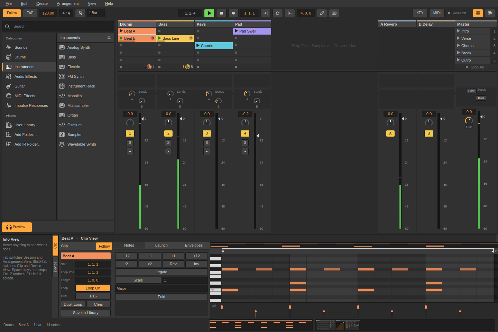
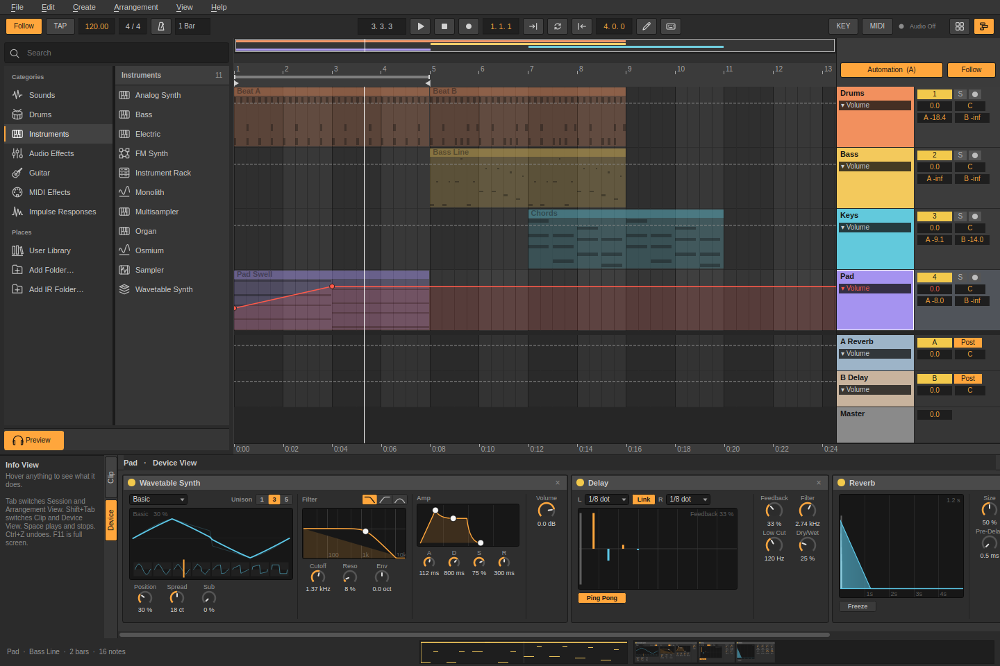
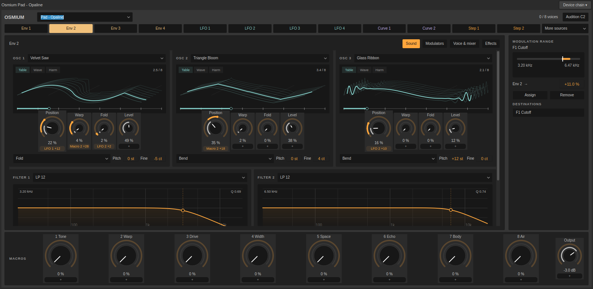
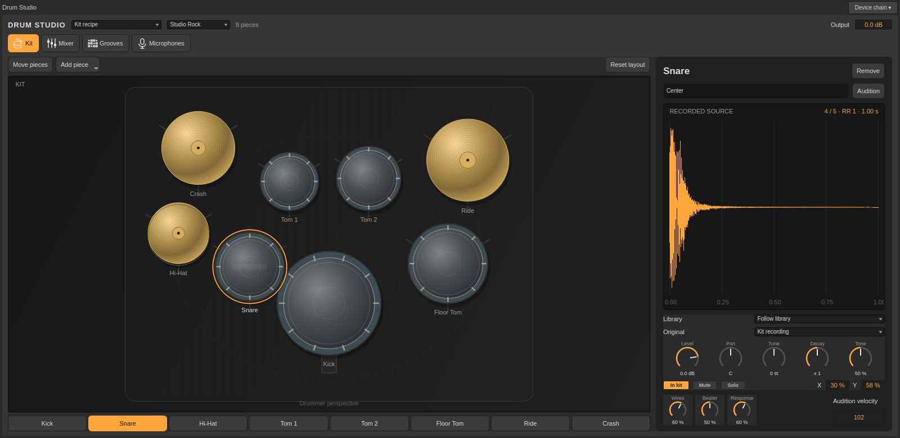
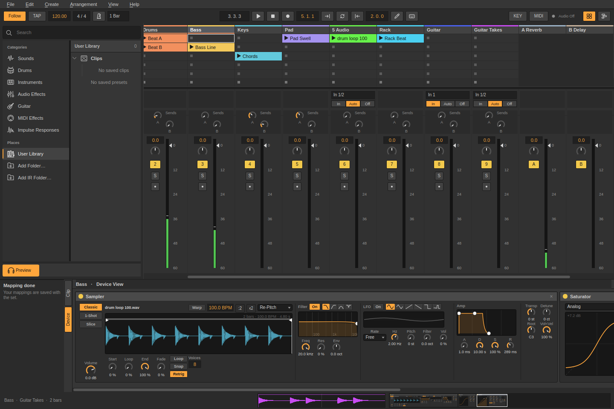

  <picture>
    <source media="(prefers-color-scheme: dark)" srcset="assets/logo/sessions-logo-light.svg">
    
  </picture>

<h3 align="center">From the first clip to the final mix.</h3>

A music-making workspace for ideas, live performance and finished tracks.

  <a href="https://github.com/ozzy-apps/sessions/releases/latest">Download Sessions</a> ·
  <a href="#sounds-to-start-with">Drum sample pack</a> ·
  <a href="docs/user-guide.md">User guide</a> ·
  <a href="https://github.com/ozzy-apps/sessions/issues">Feedback</a>

Start with a beat. Add a bassline. Try a different scene. Sessions lets you build music in a grid of clips, play with arrangements in real time, and bring everything together on a timeline—with instruments, effects and recording in one place.

## Make it your own

**Play with ideas.** Launch clips and scenes, sketch MIDI parts, shape audio loops and turn a live session into an arrangement.

**Find your sound.** Explore Osmium's morphing wavetables, build a kit in Drum Studio, layer samples or plug in a guitar. There are 63 built-in instruments and effects, from EQ and dynamics to pitch processing, modulation and reverb.

**Record and finish.** Capture audio and MIDI, record another track or the master mix, edit takes, automate your devices and export your track to WAV. Recovery snapshots and project backups help keep the work safe.

<table>
<tr>
<td width="50%"> <b>Shape the whole track</b> Audio, MIDI and automation on one timeline.</td>
<td width="50%"> <b>Go deeper with Osmium</b> Morphing wavetables, modulation and hands-on sound design.</td>
</tr>
<tr>
<td> <b>Build your rhythm</b> Recorded drums, articulations, grooves and kit mixing.</td>
<td> <b>Give it the finishing touch</b> EQ, dynamics, space and movement.</td>
</tr>
</table>

## Get Sessions

[**Downloads and release notes →**](https://github.com/ozzy-apps/sessions/releases/latest)

| Platform | Package |
| --- | --- |
| Debian / Ubuntu 24.04+, 64-bit | [.deb installer](https://github.com/ozzy-apps/sessions/releases/latest/download/sessions-linux-amd64.deb) |
| Linux, 64-bit (glibc 2.39+) | [AppImage](https://github.com/ozzy-apps/sessions/releases/latest/download/Sessions-linux-x86_64.AppImage) |
| Linux with Flatpak, 64-bit | [Flatpak bundle](https://github.com/ozzy-apps/sessions/releases/latest/download/Sessions-linux-x86_64.flatpak) |
| Windows 10 / 11, 64-bit | [Portable ZIP](https://github.com/ozzy-apps/sessions/releases/latest/download/Sessions-windows-x86_64.zip)—extract and run `Sessions.exe` |

Linux is the established platform; Windows is an early build awaiting physical audio and MIDI testing. Sessions currently uses its own devices; VST/AU plugin hosting is not included.

On startup, Sessions checks for a newer release. Choose **Download**, **Postpone** for 24 hours, or **Skip this version**. Downloads open in your browser; save your work and close Sessions before installing. You can turn startup checks off in **Preferences → Startup**, or check manually through **Help → Check for Updates**.

## Sounds to start with

Three recorded AVL drum kits are included, so you can start playing immediately.

[**Download the Sessions Drum Collection →**](https://github.com/ozzy-apps/sessions/releases/download/drum-content-v1/sessions-drum-content-v1.zip)

Add six more acoustic libraries: Big Rusty Drums, Swirly Drums, Frankensnare, DRSKit, Naked Drums and MuldjordKit. The optional pack contains 6,061 recordings with velocity layers, repeated-hit variations and recorded microphones where available. About 1.2 GB extracted; credits and CC0/CC BY 4.0 licenses are included.

Extract the ZIP, then open **Help → Sample Packs → Locate Drum Studio content** and select its `drum-content` folder. The same screen lists new packs as they are added. [Sample-pack guide](docs/sample-packs.md).

## Keep your hands on the music

Play and record from a MIDI keyboard, or use the computer keyboard. Map controls to your setup. Native Linux profiles support the **Nektar Impact LX49+/61+** and **Akai APC Key 25**, including clip launching and pad feedback. [Controller setup](docs/nektar-impact.md).

Choose a dark, light or custom theme and a layout that suits your screen.

[Build from source](docs/building.md) · [Release packaging](docs/releasing.md) · [Third-party credits](distribution/THIRD-PARTY.md)

---

Made with love by Ozzy ♥ © 2026 Ozzy. All rights reserved. 
Found a bug? Have a request? Need hardware supported? 
<a href="mailto:sessions@ozzy.co.nl">sessions@ozzy.co.nl</a>

