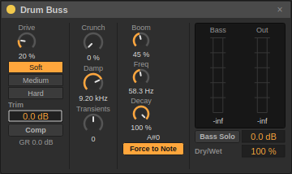

# Drum Buss · Sessions 0.31

Load **Browser → Audio Effects → Drum Buss** after an instrument, on an audio track, group or return. The compact panel follows the supplied three-column reference, with Sessions' device surfaces, accent and meters.



This is Sessions' own processor, informed by the [official Drum Buss reference](https://www.ableton.com/en/live-manual/12/live-audio-effect-reference/#drum-buss). It is not a bit-identical emulation. All 14 parameters support set/preset persistence, undo, automation and MIDI mapping.

| Control | Sessions behavior |
| --- | --- |
| Trim | −24 to +24dB before processing; the dry branch keeps its original input level |
| Comp | Stereo-linked 3:1 compressor, −18dB threshold, 6dB knee, 2ms attack, 85ms release, +3dB makeup |
| Drive | Amount and input gain for the chosen distortion character |
| Soft / Medium / Hard | Soft waveshaping; a linked limiter; clipping with bass emphasis. Character changes crossfade |
| Crunch | Sine saturation on the mid-high content above 350Hz |
| Damp | A smoothed low-pass, 1–20kHz; fully clockwise opens it |
| Transients | Shapes the envelope above 100Hz. Positive adds attack/sustain; negative reduces sustain while retaining attack |
| Boom | Amount of added, centered resonant bass; no free-running oscillator |
| Freq | 30–120Hz resonator tuning; the readout shows effective frequency and nearest note |
| Decay | Resonator T60 from 40ms to 2s, plus tightening of the incoming low-band tail below 100% |
| Force to Note | Keeps effective tuning at the nearest equal-tempered MIDI note while enabled |
| Bass Solo | Auditions only the added Boom signal; Boom at zero gives silence on this branch |
| Output | Final −24 to +12dB gain, after the parallel mix |
| Dry/Wet | Phase-matched parallel processing, 0–100% |

Bass and Out meters show peak dBFS; red indicates full scale. GR beneath Comp displays gain reduction. The displayed octave follows Sessions' normal MIDI note naming. For a chosen key, enable Force to Note and move Freq until the intended pitch appears. Low tuning and long decay can overlap successive kicks; use Bass Solo and the Bass meter to set the tail, then restore the full signal.

Trim, Output and Dry/Wet value fields accept the units displayed: type `6` for +6dB, `-6` for −6dB, `50` for 50%. Shift drags finely; Delete resets. For punch, start with modest Drive/Comp and little Boom, then match output level. Negative Transients and short Decay can tighten recorded room sound. Bass Solo is part of the processed branch, so Dry/Wet still controls how much original input is present.

## Audio implementation

`audio/DrumBuss.cpp` contains an allocation-free processor with shared 64-tap FIR coefficients and 4× oversampling for the nonlinear stages. The dry reference follows the same resampling filters and Linkwitz–Riley bass crossover phase, so its parallel blend does not introduce unmatched paths. The resampling filter adds about 16 output samples of fixed delay (about 0.33ms at 48kHz); it is not a zero-latency wire bypass, and the host currently has no automatic track delay compensation. The bass crossover has a flat summed magnitude response.

A fourth-order high-pass isolates transient processing. A separate fourth-order crossover lets Decay reduce incoming bass without subtracting an out-of-phase low-pass copy. The mono low-band derivative excites a damped complex resonator: its rotation sets frequency, its radius sets decay, and it stays silent without input. Sustained resonant input is bounded and the added bass soft-limited. Gains, amounts, mode transitions, filter coefficients and resonator tuning glide. No files, locks or dynamic allocations occur in processing or panic.

```sh
QT_QPA_PLATFORM=offscreen ./build/sessions_drum_buss /tmp/drum-buss
```

Focused checks exercise harmonic/alias behavior, compression, transient bands, both decay paths, measured resonator tuning, parallel alignment, stereo separation, gain units, silence/panic, extreme settings/sample rates, automation, serialization, presets and actual UI controls. Optional output adds Dark/Light/chain captures and a shared-gain before/after reel using recorded Rock, DnB, Techno, Metal and Reggae kits. [Audition timing guide](drum-buss-audition.md). See the manual checklist for hardware listening checks.
