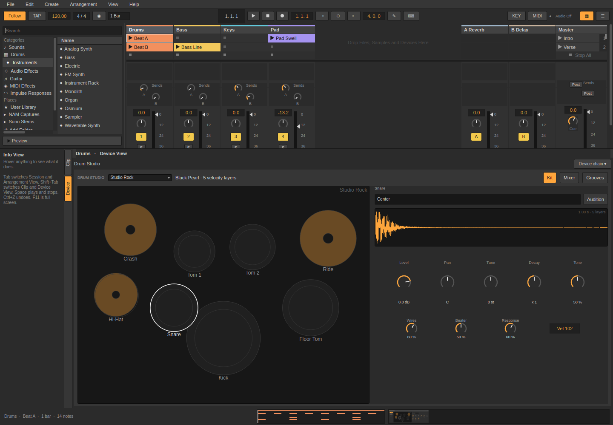
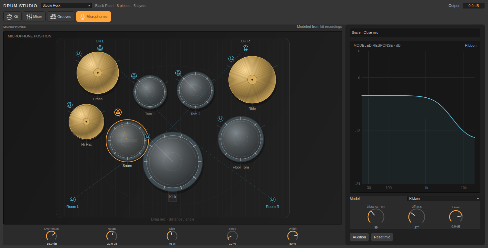

# Drum Studio

Load **Browser → Drums → Drum Studio**. Click **Expand** to work inside Sessions’ device pane. The upper Session/Arrangement stays visible; drag the divider to resize the editor. **Device chain ▾** collapses it. Osmium uses the same host, with Sound, Modulators, Voice & mixer and Effects pages. Device surfaces use Sessions’ gray panels, displays, accent and theme settings.



## Recorded kits

| Recipe | Recording | Character |
| --- | --- | --- |
| Studio Rock | Black Pearl | Balanced Pearl kit |
| Vintage | Red Zeppelin | Low-tuned Ludwig kit |
| Tight Pop | Black Pearl | Shorter, brighter articulation |
| Metal | Red Zeppelin | Defined attack and damped shells |
| Jazz | Blonde Bop | Smaller Tama kit, longer natural tails |
| Big Room | Red Zeppelin | Natural large-kit voicing; raise Room for space |

The six kit recipes and the original 66 parameter indices keep their saved meanings. Piece and microphone controls are appended; old projects load with every piece present, original source selection and neutral microphone models.

The original banks contain 285 unmodified mono recordings provide five velocity layers for each of 19 articulations in three kits. GM kick 35/36, snare 38/40, side stick 37, clap 39, hats 42/44/46, toms 41/43/45/47/48/50, crashes 49/57, china 52, splash 55, ride 51/59 and bell 53 are mapped. In these banks, the high tom uses the recorded rack tom tuned up five semitones. Their velocity layers are separately recorded strikes, not round robins. Sources are shared between instances, loaded outside audio rendering; a fixed 64-voice pool plays them at the output rate.


## Additional recorded libraries · 0.41

Six additional libraries are available in **Browser → Drums** and the top **Library** selector: Big Rusty Drums, Swirly Drums, Frankensnare, DRSKit, Naked Drums and MuldjordKit. Install the separate content package. Per-piece **Library** overrides combine sources; **Recorded source** chooses an alternate close mic where supplied. Native maps support velocity groups, round robins and aligned stereo overhead/room recordings. [Install, controls, credits and scope](studio-expansion.md).

## Kit stage

**Kit** shows a scalable native kit drawing with shells, tension lugs, cymbal grooves, stands and hit feedback. Click a piece or its bottom selection button to select and audition it. The inspector offers articulations, a large waveform of the actual recording at the audition velocity, and Level / Pan / Tune / Decay / Tone. Its source cache reads each recording once per display width or layer change. A cyan dashed curve shows additional damping for decay below ×1. Wires and Beater shape snare/kick attack.

- **Source** swaps the selected piece between Black Pearl, Red Zeppelin and Blonde Bop, or follows the kit recipe. All other pieces keep their selections. Recipe tuning/damping remains global.
- **Remove**, **In kit**, or Delete while the stage has focus removes a piece from playback. **Add piece** restores a removed slot; clicking an empty stage slot or its `+` selection button also restores it. Eight fixed GM groups are available: kick, snare, hats, three toms, ride and crash. Crash/splash/china articulations share the crash slot; this update does not add unlimited independent kit slots.
- **Move pieces** enables dragging. Both coordinates are saved and undoable together. Horizontal position offsets stereo placement; vertical position arranges the drawing. X/Y fields offer precise editing. **Reset layout** restores positions without changing sounds or membership.
- The waveform follows the selected articulation and velocity layer. **Audition** and Enter/Space on the stage play a present piece. Removed pieces ignore incoming notes; a removed Solo channel does not mute the remaining kit.



## Microphones

**Microphones** provides a second large stage with selectable close mics, an overhead pair and a room pair. The inspector offers **Recording**, **Dynamic**, **Condenser** and **Ribbon** generic tonal models. These models color existing recordings; they are not measured emulations of branded mics or alternate recorded microphone channels. The page identifies them as modeled from kit recordings.

- Drag a close-mic handle to change its **distance** (0–100 cm) and **off-axis angle** (0–90°). Distance changes gain and adds propagation delay beyond the neutral 10 cm position. Angle changes sensitivity and high-frequency response. New close-mic settings are smoothed during playback and do not alter the overhead/room source sends.
- Select either overhead handle to edit the pair. Horizontal dragging edits **Width**, vertical dragging edits **Height** (0.5–3 m). Height changes level and adds delay beyond 1.5 m.
- Drag a room handle vertically to edit **Distance** (1–8 m). Distance changes level and adds pre-delay beyond 3 m. Room Size continues to set the reverb geometry.
- The large **Modeled response** plot follows the same shelf coefficients, angle and distance gain used by the processor, at the engine sample rate. It is a static tonal response; it excludes the recorded acoustics, overhead enhancement and room reverb. **Reset mic** restores just the selected mic's model/placement controls.

**Mixer** retains eight faders, Pan, Mute / Solo and ambience/output controls. Mute wins over Solo. Overheads, Room, Room Size, Bleed and Width create modeled ambience from the original mono sources. Expansion libraries use recorded OH/Room channels where available; Room Size affects modeled reverb only. Repeated hits overlap; hat strikes close earlier hats with a short fade. All Off fades active hits.

The editor stays inside Sessions, shares automation/MIDI mapping and undo, follows Dark/Light themes and retains its page through collapse/reopen. Its 143 controls stay within the existing 192-parameter engine capacity.

## Grooves and clips

92 one/two-bar grooves in 19 categories: Rock, Pop, Funk, Hip Hop, House, Drum & Bass, Metal, Jazz, Reggae, Latin, Blues, Punk, R&B, Fills, Techno, Breakbeat, Disco, Afrobeat and Dubstep. Patterns include backbeats, ghost-note breaks, double kicks/blasts, one drop, steppers, shuffles, dance patterns and fills. They are original programmed patterns, not transcriptions or sampled break recordings.

**Grooves:** choose a category and/or search a name. The grid shows hit velocity and placement. **Preview** loops at the set tempo, without inserting a clip or starting transport. Preview stops when leaving the page, collapsing or changing tracks. Velocity/Timing adjust deterministic humanization, shared by preview, clip creation, drag/drop and MIDI export. The loop length is one/two bars at 4/4.

- Drag a groove onto a Session slot or Arrangement lane. MIDI tracks receive the clip; dropping onto an audio track creates a MIDI track with Drum Studio.
- **To Clip** or double-click inserts an editable MIDI clip in this track’s next empty slot, in one undo step. Play it at the set tempo and edit it in the normal piano roll.
- **Export MIDI…** writes SMF type 0, 960 PPQN, GM MIDI channel 10, tempo metadata, a 4/4 time signature and exact end-of-loop placement. Every note-on has a note-off. Exports use the groove’s suggested tempo; Sessions clips follow the set tempo.
- The release ZIP contains all 92 `.mid` files and 92 `.sessionsclip` files, grouped by style. Drag native clips into Sessions or copy them into the Clips folder shown by User Library. MIDI files can be opened by other DAWs.

## Sources and reproduction

Samples: **Glen MacArthur, AVL Drumkits / Bandshed Records**, from [the author’s collection](https://www.bandshed.net/avldrumkits/). The selected/remapped library is named **Sessions Acoustic Collection** and carries CC-BY-SA 3.0 with the author’s exception allowing produced music to be freely licensed. Attribution and complete license notices are included in [assets/drums/README.md](../assets/drums/README.md), its PDF and legal code; these files ship in the package. This separate sample license does not change the application’s code license.

`scripts/fetch-drum-samples.py` reproduces the bundled unmodified files from checksum-pinned source archives. Normal builds and playback require no downloads. CMake installs the recordings under `share/sessions/drums`; build-tree runs use the bundled source directory. The library occupies about 67MB on disk and 134MB as shared decoded mono audio.

```sh
QT_QPA_PLATFORM=offscreen ./build/sessions_drum_studio /tmp/drum-studio
```

This runs the recorded-layer, GM map, audio headroom/dynamics/choke, groove timing, SMF parser, native-clip round-trip and embedded UI checks; optionally writes the two clip formats, a multi-style audition WAV, guide and screenshots. Automated checks verify audio behavior and bounds; use the manual checklist to audition on your playback system.

## Additional sample sources

[Drum sample research](drum-sample-research.md) lists six additional libraries, primary-source commercial-use licenses and download locations. Karoryfer's Big Rusty Drums, Swirly Drums and Frankensnare declare CC0. The documented DRSKit, Naked Drums and MuldjordKit SFZ ports declare CC BY 4.0. All six are downloaded and mapped for Sessions 0.41. The separate content installer supplies their main GM articulations and recorded mic streams. See the [integration guide](studio-expansion.md).

```sh
QT_QPA_PLATFORM=offscreen ./build/sessions_drum_studio_redesign /tmp/drum-studio-redesign
```

This audit checks append-only migration, actual source swaps, removed-piece silence, microphone transfer functions and callback allocations, saved placement, undo, dragging and narrow/wide themed native captures.
