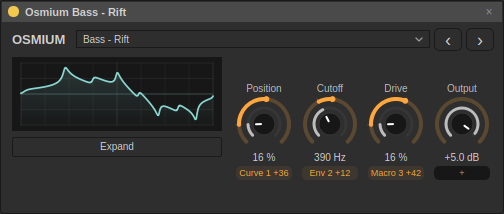
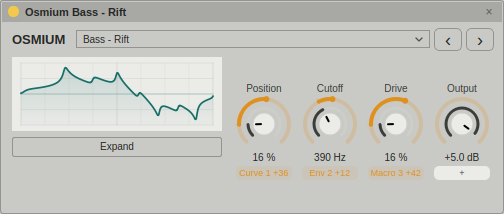

# Osmium Gesture Bass · 0.43

24 bass presets join the existing 88 sounds. Search the names below in the compact or expanded preset selector, or in Browser → Sounds. The compact panel's previous/next buttons wrap through all starting sounds and factory presets; loading a sound is one undo step.

Each patch has two independently authored, non-looping contours with uneven node spacing and separately bent, smooth segments. The first shapes the main oscillator and filter; the second moves the colour oscillator and supplies an opposing filter gesture. Four shaped ADSRs handle amplitude, initial bite, slower folding and the transient. No default route uses an LFO or stepper, and all envelope loops are off. The contours retrigger on notes, finish once, then hold their endpoints. There is no random clock or amplitude gating; a small per-note colour offset adds variation.

Play around **MIDI 28–43**. Start with A1 (MIDI 33); hold for three seconds to hear the longer gestures. Short notes reveal the initial articulation; overlapping mono notes retrigger the contours with a short glide. Curve lengths follow tempo, while the internal gestures use uneven timing instead of regular subdivisions. The longest contour is eight beats (four seconds at 120 BPM). The amplitude sustains while the harmonic movement settles.

A sine-like layer at the played pitch and a separate octave-down sub support the moving harmonics. Defaults are dry, without chorus, reverb or delay; selected reeses use oscillator unison. Velocity controls level and brightness, and channel pressure adds grain. The eight macros remain **Tone · Warp · Drive · Width · Space · Echo · Body · Air**. Width adds optional chorus; Space and Echo add optional ambience. Body increases the sub level. The original 88 patches retain their exact names, values, routes and curves.

| Preset | Character / gesture |
|---|---|
| Rift | Thick reese; early snarl and a late shoulder |
| Silt | Round low bass; swallowed attack and liquid rebounds |
| Magma Mouth | Vocal growl; fast opening, catch and closing throat |
| Boulder | Dense, restrained bass; three unequal shoulders |
| Tar Pit | Sticky dark bass; delayed strain and settling folds |
| Loose Jaw | Rubber talking bass; staggered jaw and throat |
| Undertow | Broad inward reese swell against a quicker ripple |
| Black Sap | Warm woody body; offset swell and upper crack |
| Broken Current | Electrical colour stutter and a long rounded fall |
| Bent Axle | Metallic reese; quick rasp and off-centre return |
| Cinder Lung | Slow inhale and two unequal furnace exhales |
| Gravel Throat | Grainy attack over a round low core |
| Velvet Bruise | Soft heavy bass with a rounded double shoulder |
| Deep Tissue | Low pressure with a delayed organic opening |
| Iron Sap | Singing metal and an irregular falling formant |
| Slow Rupture | Late opening, brief catch and a warm sustained tail |
| Tectonic | Broad reese with two unequal pressure ridges |
| Aftershock | Initial impact and a smaller delayed timbre accent |
| Rubber Maw | Elastic vowel, hesitation and a second unequal bite |
| Crooked Root | Woody flick followed by a broad asymmetric swell |
| Molten Core | Fast surface curl over a slower internal fold |
| Heavy Weather | Dense reese with uneven upper swells |
| Dark Matter | Deep smooth body with a brief harmonic flare |
| Fault Bloom | Restrained snap, delayed vocal bloom and closing fold |

Reproduce the new-only preset files, levels, listening guide and audition WAV with:

```sh
./build/sessions_osmium_bank --gesture dist/osmium-gesture
```

The reel uses the production synth at 48 kHz / 174 BPM. Each 7.5-second slot contains a held A1, shorter articulations and a sustained closing note; the same 0.8 playback gain is applied throughout, without per-preset normalization. This exposes the longer contours as well as the attack. The bank audit measures each contour's actual audio contribution, sustained energy below 150 Hz, long-note one-shot completion, release, pressure, velocity and every macro. The full suite also protects all 88 previous patches with an exact content fingerprint.

The final export passes 682 checks; the full 112-preset bank passes 2,346 checks, the native editor/preset controls pass 55 checks, and all 27 regression suites pass. Default new-patch benchmark peaks are −12.83 to −10.99 dBFS; the shared-gain reel peaks at −12.87 dBFS.




