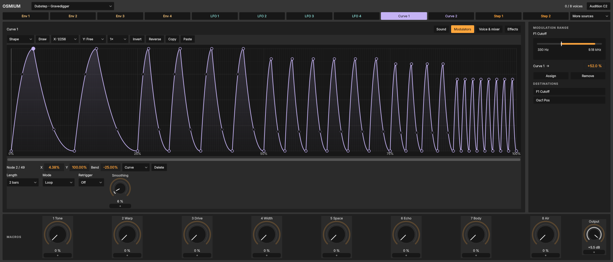

# Osmium — Wobble Basses · 0.39

20 fat wobble basses for Osmium: ten **Dubstep** (voiced at 140 BPM, half-time) and ten **DnB Bass** (voiced at 174 BPM). They sit after the 40 Drum & Bass sounds in Osmium's patch selector: type `dubstep` or `dnb bass` there, or search **Osmium** in Browser → Sounds.

## The wobble changes rate on its own

A wobble bass gets its life from rate changes: a bar of quarters, then eighths, a triplet fill, a sixteenth or 1/32 roll. In these presets those changes are drawn into **Curve 1**, Osmium's phrase curve, instead of being automated. Each Curve 1 is a one-, two- or four-bar phrase made of runs at different rates, so one held note already plays the whole variation. The table below lists every phrase.

- **Locked to the song.** Curve 1 follows the set's bars (Retrigger Off), so the phrase lines up with your beat wherever a note starts. Hold a note through the phrase, or play a bass line: the wobble keeps its place in the bar. *Jump Up Wheeze* and *Stab Rewind* are the exceptions: they restart their one-bar phrase with every note, for stabs.
- **Triplets and dotted notes live in the curve.** Osmium's Rate choices are straight values only; drawn phrases add the 1/4 and 1/8 triplets, 1/16 triplets and dotted eighths.
- **Curve 2** drifts the oscillator's timbre over four bars, so each repeat of a two-bar phrase sounds a little different.

## Changing the wobble length

Every Osmium control can be automated, including the phrase's length. On the Modulators page, Curve 1's **Length** menu is the automatable **Curve1 Rate** parameter: 4 bars, 2 bars, 1 bar, 1/2, 1/4, 1/8, 1/16 or 1/32. (Free plays a phrase over one bar.)

- **Automation lane:** in the Arrangement, show the Osmium track's automation, choose **Curve1 Rate** and draw steps on bar lines. Because the phrase is locked to the song, a switch stays in time: it continues from where the phrase would be at the new length, and a switch to 1 bar or shorter on a bar line starts it from the top. *2 bars → 1 bar* plays the same phrase twice as fast; *1/16* turns it into a buzz. Switching mid-note takes effect at once.
- **Clip envelope:** the same parameter in a MIDI clip's envelopes varies the length per clip or per scene.
- **Hands on:** MIDI-map a controller knob to Curve1 Rate to switch lengths while you play.
- **LFOs:** LFO 1–4 Rate work the same way, if you build a wobble from an LFO instead.

Modulation sources (macros, LFOs, the steppers) cannot move a Rate. Use automation, a clip envelope or a MIDI mapping. To draw your own variation, open Curve 1, set **X** to a grid such as 1/64, turn on **Draw** and paint over the phrase. Each pass is one undo step. [Osmium editing](osmium-editing.md) covers node editing.

## Playing them

- Play around **F1 (MIDI 41)**: the sub oscillator sounds an octave below, around 44 Hz. Every bass is mono with a short glide.
- The filters follow the keyboard (Key > Cutoff 100 %), so the wobble keeps its colour from E0 to F2. Cutoff values therefore read as at C3 (MIDI 60): Gravedigger's 330 Hz plays as 110 Hz at F1.
- **Velocity** opens the filter slightly, for accents.
- The same eight macros as the rest of the bank: **Tone · Warp · Drive · Width · Space · Echo · Body · Air**. Body adds sub, Width spreads the unison, Space and Echo add a little reverb and delay. No macro changes pitch or timing.
- The phrases use 21–91 curve nodes. Sessions 0.31.1 and later keep all of them in sets and presets; older builds read only the first 32.
- Levels match the Drum & Bass bank: about −12 dBFS peak with the macros at zero, at most −9.5 dBFS with all eight at maximum. Nearly all the level sits below 150 Hz; see [levels](osmium-wobble-bass-levels.csv).

## The presets

Phrases are listed beat by beat. T marks a triplet, ×4 counts wobbles, and “2 beats” gives a run's length.

### Dubstep · voiced at 140 BPM

| Preset | Sound | Curve 1 phrase |
|---|---|---|
| Gravedigger | Growl and saw through a 24 dB low-pass, centred sine sub. The classic. | 2 bars: 1/4 · 1/4 · 1/8 · 1/8 · 1/8T · 1/8T · 1/16 · 1/32 roll |
| Yoi Machine | Formant oscillator: the vowel and the filter move together (yoi). | 2 bars: dotted 1/8 ×4 (3 beats) · 1/4 · 1/8T · one long half note · 1/16 |
| Riddim Hammer | Square riddim, 12 dB low-pass, hard clipped, with gaps. | 2 bars: 1/8T · rest + 1/16 ×2 · 1/8T · 1/8T · 1/4 · 1/16T · rest · 1/32 |
| Tearout | Sync saw through the Scream filter and a wavefolder. | 2 bars: 1/16 · 1/8 · 1/16 · 1/32 · 1/16T · 1/16T · 1/8T · 1/32 |
| Robot Talk | Metallic table, ring modulation, a comb after the low-pass, a stepped 1/16 timbre sequence. | 4 bars: 1/4 · 1/8T · 1/8 ×2 beats · 1/4T ×2 beats · 1/16 ×2 beats · 1/8T · 1/16T · one half · 1/8 ×2 beats · 1/16 · 1/32 |
| Deep Wub | Slow and deep, the heaviest sub. | 4 bars: halves · quarters · a half then 1/8 · 1/8T then 1/4 |
| Triplet Grinder | Phase-modulated growl that lives on triplets. | 2 bars: 1/4T ×2 beats · 1/8T ×2 beats · 1/16T · 1/8T · 1/4 · 1/16T |
| Stutter Gate | Square chops between open wobbles; the sub keeps going. | 2 bars: chops 1/8 · 1/16 · wobbles 1/4 ×2 · chops 1/16T · 1/32 · wobble 1/8T · chops 1/16 |
| Laser | Hard-sync sweep that follows the phrase, band-pass after the low-pass. | 2 bars: 1/8 · 1/8T · 1/4 ×2 · 1/16 · 1/8 · 1/16T · 1/32 |
| Halftime Growl | Growl table in formant mode and a drifting notch after the low-pass. | 4 bars: 1/4 ×2 · 1/8 ×4 · 1/8T · 1/16 · one half · a bar of 1/8 · 1/4 · 1/16T · 1/8T · 1/32 |

### DnB Bass · voiced at 174 BPM

| Preset | Sound | Curve 1 phrase |
|---|---|---|
| Neuro Talker | Formant neuro with a six-step 1/16 vowel sequence. | 2 bars: 1/8 · 1/16 · 1/4 ×2 · 1/8T · 1/8 · 1/16T · 1/32 |
| Jump Up Wheeze | Rising wheeze on a resonant 12 dB low-pass. **Restarts with every note.** | 1 bar: 1/4 · 1/8 · 1/8T · 1/16 |
| Roller | Detuned reese with smooth, sine-like rolls. | 2 bars: 1/8 ×2 beats · 1/16 · 1/8 · 1/8 ×2 beats · 1/8T · 1/16 |
| Liquid Wobble | Soft and round, with a little chorus and space. | 2 bars: 1/4 ×2 · 1/8 ×2 beats · 1/4 · 1/8T · one half |
| Foghorn | Huge pulse foghorn over a square sub. | 4 bars: halves · 1/4 ×2 · 1/8 ×4 · a whole-bar swell · 1/8T ×2 beats · 1/16 · 1/32 |
| Halftime Crusher | Folded halftime bass built on triplets. | 4 bars: 1/4T ×2 beats · 1/4 ×2 · 1/8T ×2 beats · one half · 1/16T · 1/8T · 1/8 ×2 beats · 1/4T ×2 beats · 1/16 · 1/32 |
| Growl Reese | Detuned reese with a formant band-pass after the low-pass. | 2 bars: 1/4 · 1/8 · 1/8T ×2 beats · 1/16 · 1/8 · 1/4 ×2 |
| Stab Rewind | Synced growl stab that ratchets up. **Restarts with every note.** | 1 bar: 1/4 · 1/8 · 1/16 · 1/32 |
| Metal Hornet | Buzzing metallic bass, comb after the low-pass. | 2 bars: 1/16T · 1/8 · 1/16 · 1/4 · 1/8T ×2 beats · 1/16T · 1/32 |
| Mutant Step | Digital sync bass with an eight-step 1/16 timbre sequence. | 2 bars: 1/8 ×2 beats · 1/16T · 1/4 · 1/8T · 1/16 · 1/4 ×2 |

## Checked by the tests

`sessions_osmium_bank` renders every preset at its own tempo and at the other genre's (140 ↔ 174), with each macro and with all eight at maximum. Each bass must:

- stay finite and below full scale,
- keep at least 70 % of its level below 150 Hz,
- move its level above 500 Hz by more than 12 dB across the phrase (measured 16–43 dB),
- hold at least three wobble rates in Curve 1, with both curves within Osmium's 257 nodes.

Two further checks automate Curve 1 Rate on Gravedigger: once inside Osmium, once through an Arrangement automation lane in the engine. The phrase switches length at the automated point, and the audio before the switch is unchanged.
