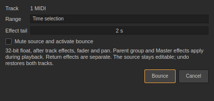
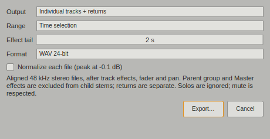

# Capture, bounce and stem export · 0.52

## Capture MIDI

Play a MIDI instrument from a controller or the computer keyboard, then choose **Create → Capture MIDI** (**Ctrl+Shift+C**). Select the track you played. Record does not need to have been enabled.

In Session View, capture uses a free slot at or below the selected scene and creates a scene if needed. It never replaces an occupied clip. In Arrangement View, a phrase played during transport goes at its original bar; a phrase played while stopped goes at the insert marker. The captured clip opens in the note editor. Undo removes the whole capture; redo restores it.

History is held in memory for up to two minutes and 4,096 notes across tracks. Capture uses the most recent phrase, separated by two seconds of silence, with a maximum length of 32 bars in 4/4. Held notes end at the capture instant. Tempo changes and loop passes retain performance order. Transport seeks separate phrases. Capture uses the current set tempo while stopped; it does not infer tempo, record controller expression, or include note-editor audition. Opening/newing a set clears the history. A successful capture consumes only that track's history. Stop an active recording first.

## Bounce an Arrangement track

Select a MIDI/audio track or group, then **Arrangement → Bounce Track to Audio…**, or right-click the timeline. Choose the time selection, whole track or loop region, and an effect tail of up to 30 seconds.

The new 48 kHz, 32-bit float file includes the source's instruments, clip and track effects, clip fades, automation, fader and pan. The whole Arrangement runs in the background, so sidechains, group routing and return sends keep their context. Rendering from the start of the song warms effects before a selected range. After the end of the range, notes are released and new clips stop; effects can ring into the chosen tail.

A new audio track is placed beside the source, after the children when bouncing a group, in the same parent group. It has unity gain, centered pan, no devices and no sends, so the printed processing is not applied twice. Parent-group and Master effects run normally during playback. Return effects are **not** baked into the bounce. The bounced clip plays at its recorded speed with Warp off.

By default, the source stays active and the bounce starts muted for auditioning. **Mute source and activate bounce** performs the switch in the same undo step. This option also affects dependencies that listen to the source's post-mixer output. Return sends are not transferred automatically. When bouncing only a range, muting the source mutes its entire track; leave the option off if the source must play elsewhere in the song. Settings for tail and activation are remembered.

The original clips and devices remain editable. Undo restores both tracks, and redo brings back the bounce. The WAV stays on disk for redo/recovery and participates in normal set saving and **Collect All and Save**. This is a print-to-a-new-track workflow, not a processor-suspending reversible Freeze system.

## Export audio or aligned stems

Open **File → Export Audio…** (**Ctrl+Shift+R**). Choose:

- **Master mix**, including Master effects and fader, with current solo/mute states.
- An individual track, group or return, after its own effects, fader and pan.
- **Individual tracks + returns**, for the default stem batch.
- **Tracks, groups + returns**, to include group outputs as separate files too.

Use the whole song, loop region or time selection. All outputs are 48 kHz stereo WAV, with 16-bit, 24-bit or 32-bit float encoding. Tail and format are remembered. Float files preserve headroom above 0 dBFS; integer files clip to their format's range and use dither. Optional normalization acts on each file independently; leave it off to retain the stems' relative levels.

Individual outputs ignore solos and respect track activators, faders, automation and pan. Each source renders in the context of the complete Arrangement: sidechains work, and return files receive all relevant sends. Child stems are tapped **before parent-group and Master effects**. A group file includes that group's children and its own processing. Returns are separate; group files overlap their child stems and should not be summed with those children as if they were independent sources. Nonlinear group/Master processing means individual stems need not sum exactly to the Master mix.

Every file in a batch has the same starting beat and sample count, including the selected tail. A `stems.json` manifest records timing, tempo, sample rate, track IDs and filenames. The parent-folder chooser creates a new **Set name Stems** folder (numbered if needed). Names are sanitized and numbered to keep duplicate track names unique on Linux and Windows.

Live Looper memory is not part of offline printing; save its loop with **Save Loop** before rendering.

Rendering uses a value snapshot. Live playback and project edits do not alter that snapshot; Session launches and monitored inputs are excluded. Cancel leaves an existing single-file destination intact and publishes no partial stem folder. A cancelled or failed bounce leaves the project unchanged. Stop recording before starting a render. Export remains fixed at 48 kHz and does not yet implement global effect-latency compensation.
