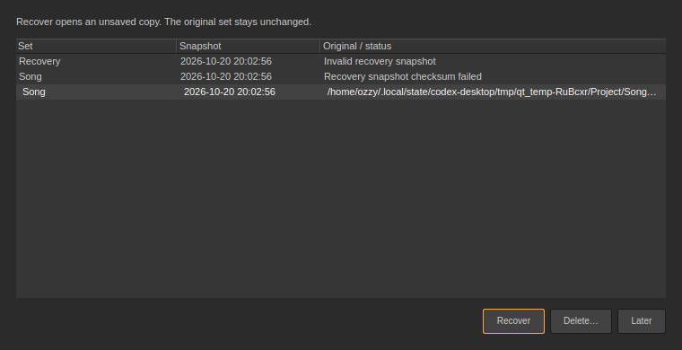

# Autosave, recovery and project backups · 0.42

## Defaults

Recovery snapshots are enabled every **two minutes** for changed sets, including untitled sets. Sessions retains the latest **three completed snapshots** for the current document. A completed recording also requests a checkpoint promptly. Unchanged snapshots are not duplicated.

**Preferences → Startup → Recovery snapshots** offers Off, 1, 2, 5 or 10 minutes. **Project backups** keeps 10 saved versions by default, with Off, 5, 10 or 20 available. Turning recovery off stops new automatic checkpoints; existing recoveries remain available.

## Recover an interrupted session

At startup, Sessions offers snapshots left by an interrupted session. Snapshots owned by a running Sessions process are excluded. **File → Recover Set…** opens the same picker later.

- **Recover** opens the selected snapshot as an **unsaved copy**, named `Song (Recovered)`. Save As chooses its destination; the original manual save stays unchanged.
- **Later** leaves snapshots available for a future startup.
- **Delete…** asks before removing every snapshot for that recovery session.

The picker shows the set, snapshot time and original path or error. If the newest snapshot is damaged, earlier valid versions remain selectable. A checksum failure prevents that snapshot from replacing the current project.



Successful manual saving retires the matching recovery when the captured state is still current. If edits occurred during saving, the newer unsaved state keeps its recovery. Closing with Save or explicit Discard, or replacing the document through New/Open, retires that document's snapshots. Cancel keeps them. Choosing Later never discards another session's recovery.

## Saving and backups

In the application, manual saves, automatic snapshots and backup serialization run on a serial background writer. Playback and recording continue, and the interface can process edits during a manual save. The saved file contains the state captured when saving began; later edits remain marked unsaved. File replacement, Close and restart are held back while the save finishes. The Info View identifies a save in progress and reports write failures.

After a successful manual save, a standard `.sessions` backup is written under:

```
<project folder>/Backups/<set name>/
```

**File → Show Backups** opens that folder. Open a backup like any ordinary set, then Save As to the destination you want. The configured count includes the newest backed-up save. Rapid repeated saves of one set can coalesce to its newest waiting version. Old versions are removed only after the replacement commits successfully. A failed backup does not invalidate a successful manual save.

Backups reference media relative to their own directory, so moving the entire project folder preserves local sample paths. **Collect All and Save** brings external samples into the project when portability is needed. Backups store set data, not copies of every audio recording or installed library.

## Recording checkpoints

Recovery includes the current Session/Arrangement takes and the elapsed portion of held MIDI notes. Capturing a checkpoint does not end a take or add an undo step. A live WAV receives a readable header at the checkpoint while retaining its write position, allowing that recorded portion to load even if the process is killed before the writer closes normally. Files referenced by a checkpoint are retained when the transport resets, so switching sets cannot delete audio already used by a saved version.

Closing or replacing a set ends active recording before asking about unsaved changes. Stop finishes held MIDI notes and gives captured audio a short opportunity to finish its latency tail. Ordinary Save during recording leaves recording running.

Recovery restores the last completed snapshot. Edits and recording data after that point may not be included. It preserves references to existing media; it cannot restore an external file that was deleted or a missing library installation.

## Storage and verification

Recovery files live in the platform's application-data directory under `Recovery/`, in a separate folder for each document session. On Linux this follows `XDG_DATA_HOME` / Qt's AppLocalDataLocation. Each folder has a process lock. Recovery snapshots retain absolute media references, their original set identity, a UTC timestamp and a SHA-256 checksum. The project data remains compatible with the existing set format.

Writes use QSaveFile atomic replacement, with short-write/commit failures reported. A recovery JSON file is limited to 256 MB. There is one active automatic job, one newest pending snapshot and at most eight waiting backup destinations; manual saves are serialized separately. The UI captures value state, and the worker never reads the live Project or Transport. Audio callbacks do no recovery file access, locking or serialization. The existing recording owner performs the small WAV-header checkpoint.

```sh
QT_QPA_PLATFORM=offscreen ./build/sessions_recovery /tmp/sessions-recovery
ctest --test-dir build -R recovery --output-on-failure
```

The focused suite uses actual killed child processes to check stale/live locks, interrupted MIDI/audio, recording file retention, corrupt snapshots, immutable state, queue coalescing, rotation, unwritable storage, portable backups, startup/manual recovery controls, save/undo/dirty/close/new semantics and responsiveness to edits during manual saving. Captures cover the picker and Startup preferences in Dark/Light.
