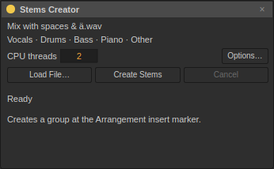

# Stems Creator

Separate a mixed audio file into **Vocals, Drums, Bass, Piano and Other**, then mix or edit the results on five audio tracks inside one group. Guitar, strings, synths and remaining instruments share **Other**. This is neural source separation; bleed and artifacts depend on the recording. It cannot identify and isolate every instrument individually.



## Create stems

1. Add **Audio Effects → Stems Creator** to a track.
2. Choose **Load File…**, or drop a local audio file onto the device. Formats follow Sessions' audio decoder (WAV/AIFF and FLAC/other libsndfile formats when available).
3. Place the Arrangement insert marker where the separated audio should begin. Choose **CPU threads** (1–8; default 2).
4. Press **Create Stems**. The progress and status show preparation, analysis and import. You can continue working; one separation runs per project.
5. Sessions opens the Arrangement with the new group. All five files have the same start and exact sample count, with warping and looping off. The source stays intact. **Ctrl+Z** undoes the entire grouped import; redo restores it.

**Cancel** stops the job and removes unfinished output. New/Open, removing the source device, changing its source, or closing the project cancels pending work. Stop recording before starting separation. Six free track slots and one free group slot are required (Sessions supports 64 tracks and 16 groups).

## Files and options

**Options… → Output Folder…** chooses a persistent destination. **Use Project Output Folder** restores the default: `Stems` inside the current recording folder (`Samples/Recorded` for a saved set, otherwise the user's Sessions recording folder). Each successful job creates a uniquely named folder containing five WAV files and a small result manifest. These files remain after undo so redo and saved sets keep working. **File → Collect All and Save** copies the referenced audio into the set's samples folder for portability.

Models and the CPU runtime are bundled in packaged builds. No Python, account, GPU or audio upload is required. Processing runs locally in a separate native process; it does not enter the audio callback. ONNX Runtime telemetry is disabled. **Model Folder…** accepts the exact five checksum-pinned model files for advanced/source setups; **Use Bundled Models** restores the default.

Input is resampled to **44.1 kHz stereo** and output uses **32-bit float WAV** without clipping. The file limit is one hour. CPU time and memory depend on length and hardware; source audio and the five imported tracks are held in memory, so long files can require several GB. The worker processes overlapping windows to bound neural activation memory. The model analyzes frequencies below about 11 kHz; higher bins use each frame's average source masks, retaining the full-band mixture sum without claiming independent high-frequency classification.

On Windows, the official ONNX runtime requires the [Microsoft Visual C++ 2015–2022 x64 Redistributable](https://learn.microsoft.com/en-us/cpp/windows/latest-supported-vc-redist). If loading the neural runtime fails, install that prerequisite and try again. Sessions does not install system runtimes automatically.

## Build and provenance

Before configuring a source build, run:

```sh
python3 scripts/fetch-stems-assets.py --platform linux
# In MSYS2 UCRT64, use python and --platform windows instead.
cmake -S . -B build
cmake --build build --parallel 4
```

The fetcher checks sizes and SHA-256 against [the asset lock](../distribution/stems-assets.json), then CMake installs the selected platform's runtime and all five models. Use `-DSESSIONS_STEMS_ASSET_DIR=/path/to/assets` for a separate cache. Flatpak packaging uses the default `build/stems-assets` directory as a second local source. The worker is `sessions-stems-worker`, next to the application executable.

Sessions uses Deezer's [Spleeter five-stem model](https://github.com/deezer/spleeter), with the [pinned ONNX conversion](https://github.com/matthewbae/spleeter-onnx-models/releases/tag/spleeter-5stems-onnx-v1) and Microsoft's [ONNX Runtime 1.31.1](https://github.com/microsoft/onnxruntime/releases/tag/v1.31.1). The Spleeter authors explicitly release code and pretrained models under MIT in their [paper](https://joss.theoj.org/papers/10.21105/joss.02154). Conversion notices (Apache 2.0) and the runtime's MIT/third-party notices ship with the application. Sessions' original code remains All rights reserved.

The five graphs return logits, not independent final masks. Sessions jointly normalizes all five using power-2 ratio masks, then reconstructs audio with a periodic Hann STFT and normalized overlap-add. Tests cover timing, reconstruction, grouped import, undo/redo, persistence, malformed output, cancellation and project lifetime. Reconstruction accuracy checks preserve the mixture; they are not a benchmark of perceptual separation quality.
