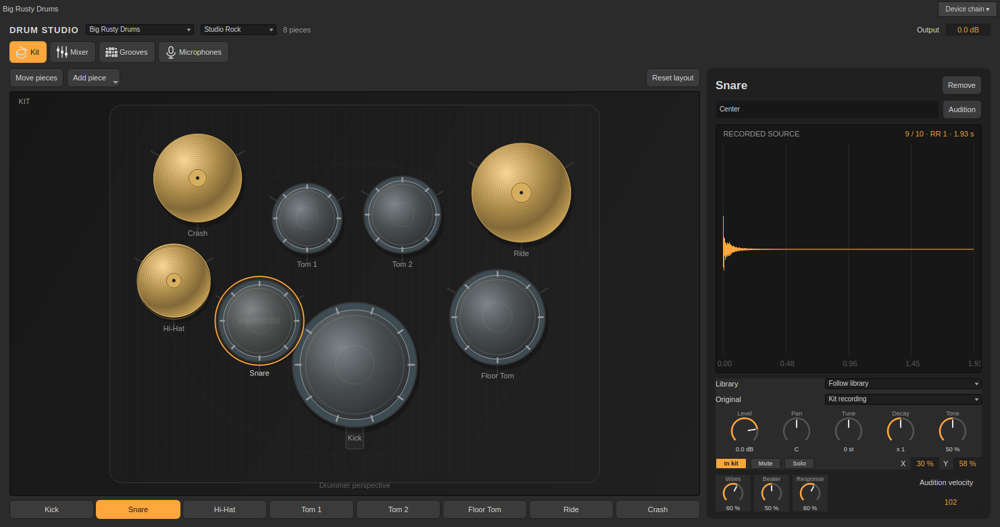
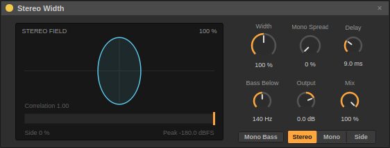

# Recorded drums, NAM tone and Stereo Width · 0.41

## Drum content

Install the matching `sessions_0.41.0+…_amd64.deb` application and `sessions-drums_0.41.0+…_all.deb` content package from `dist/`. Content depends on Sessions 0.41 or newer and `libsndfile1`. The original three AVL banks remain in the application installer. Additional content occupies approximately 1.17 GB before packaging.

Open **Browser → Drums** and choose **Big Rusty Drums**, **Swirly Drums**, **Frankensnare**, **DRSKit**, **Naked Drums** or **MuldjordKit**. Each is a Drum Studio preset selecting its recorded library. In an existing Drum Studio, use the top **Library** selector. **Kit recipe** retains the original AVL recording selection and recipe behavior.

Select a piece on the Kit stage. Its **Library** field follows the global library, retains the **Original source**, or chooses another expansion. The existing **Source** selector still picks Black Pearl, Red Zeppelin or Blonde Bop for the original path. Recipe tuning/damping, stage placement, mic models, mixer and grooves remain available.

| Library | Mapped articulations | Recorded strikes | Decoded mic recordings | License |
| --- | ---: | ---: | ---: | --- |
| Big Rusty Drums · Karoryfer | 18 | 480 | 1,096 | CC0 |
| Swirly Drums · Karoryfer | 19 | 940 | 940 | CC0 |
| Frankensnare · Karoryfer | 3 | 84 | 252 | CC0 |
| DRSKit · DrumGizmo | 17 | 278 | 926 | CC BY 4.0 |
| Naked Drums · Wilkinson Audio | 19 | 580 | 1,900 | CC BY 4.0 |
| MuldjordKit · DrumGizmo | 18 | 313 | 1,058 | CC BY 4.0 |

A strike can contain several aligned microphones. Counts include GM aliases sharing files; packaged audio contains **6,061 unique unmodified files**. Native maps retain the selected articulations' velocity recordings and round robins. Karoryfer maps use uniform velocity boundaries; DrumGizmo/Wilkinson ports retain their SFZ boundaries. Complete upstream downloads remain in `dist/drum-sources/`; the installer contains the main GM maps and their referenced audio.

Frankensnare expands three snare articulations. Other notes and unmapped articulations fall back to the original recipe. Optional upstream kit variations, CC-driven articulations and arbitrary SFZ scripts/effects are not interpreted. This is a native Sessions mapping rather than a general SFZ player.



## Loading and memory (0.46)

Recorded libraries load in the background: choosing one never freezes the window.
- **While it loads:** each drum keeps playing the library it played before, or the built-in kit if it had none, so there's no gap. The new one takes over as soon as it's ready, and drums that are still ringing aren't cut off.
- **Status:** the Drum Studio top bar, the kit stage and the recorded-source view show "Loading Naked Drums 43 %". If a library can't be read they say why ("… couldn't load: …"), and they say when one isn't installed.
- **Changing your mind:** a library you switch away from while it loads is abandoned.
- **Automation:** library automation, clip envelopes and macros preload only the libraries they actually move through, not all six.
- **Memory** (**Preferences → Audio → Drum libraries**): libraries in use always stay loaded. Ones you switched away from stay ready for an instant switch back while all loaded libraries together stay under the limit: 2, 4 (to begin with), 8 or 16 GB, or no limit. The same row shows how much is in memory now.

Exports (and the regression suites' own engines) still decode a library before rendering, so an export always uses the recorded kit.

## Recorded microphones

On **Microphones**, **Recorded source → Primary / Alternate** switches the close recording where supplied, such as snare top/bottom or kick in/sub. Without an alternate, Primary remains active. Overhead and room buses use aligned recordings where provided; other sources retain modeled ambience. Recorded ambience continues after a shorter close recording ends.

The separate **Model** controls apply Recording / Dynamic / Condenser / Ribbon coloration. Position controls model gain, delay and tone; they cannot recreate a physically different recording position. **Room Size** affects modeled reverb, not acoustics already captured in a room recording.

Decoding happens outside audio rendering. Selected immutable banks are shared between instances; unused banks can be released. A bank requires approximately 117 MB–2.1 GB of decoded memory. Automating library selection preloads all six banks (about 5.5 GB), keeping decoding and allocation out of callbacks. This version loads banks into memory rather than streaming. The global selector reports **Content missing** when its recordings are unavailable.

## NAM tone

**NAM** now has **Bass**, **Mid**, **Treble** and **Presence**, each −12 to +12 dB with flat defaults. They are host EQ after capture processing/normalization and before the cabinet IR: a 120 Hz bass shelf, 750 Hz mid bell, 2.2 kHz treble shelf and 4.8 kHz presence shelf. They do not require a capture with its own parametric controls. Old eight-control devices acquire four flat controls without renumbering.

## Stereo Width

Load **Audio Effects → Stereo Width**.

- **Width**, 0–200%: zero makes mono; 100% retains the original side level. Higher settings increase sides while preserving the centre.
- **Mono Bass** removes low-frequency side information using a 24 dB/oct high-pass. **Bass Below** spans 40–500 Hz; mid information is retained.
- **Mono Spread** adds the difference between mid and a short delayed copy to the side channel. **Delay** spans 2–25 ms. Added spread cancels in mono.
- **Output** and **Mix** set gain and wet amount. The dry path has no added latency.
- **Monitor** selects Stereo, Mono or Side. Correlation, side level and peak measure output audio; the outline illustrates the width setting.

Controls are smoothed and delay storage is preallocated. Widening can raise channel peaks; use Output for headroom and Mono/Side monitoring to check the result. No automatic limiter is applied.



## Drum Rack waveform shelf

Click **Drum Rack → Waveform** to slide open a stereo waveform shelf inside the device chain. It follows the selected pad and retains its opening state through panel rebuilds during the session.

Use **+ / −** or the wheel to zoom up to 64×. Drag to pan; **Fit** shows the complete sample. Click the waveform or **Audition** to play the pad. **Load sample…** replaces its recording through the existing background loader. A different sample automatically fits the view. These controls change the view, not the playback region.

## Reproduction and checks

`content/drums/licenses/` includes notices, credits and pinned release hashes or Git commits. `content/drums/SHA256SUMS` covers every packaged audio file. Karoryfer audio is CC0; the DrumGizmo/Wilkinson ports use CC BY 4.0 with author and kinwie mapping credits retained. The native manifest changes the mapping; recordings are unmodified. [Primary source research](drum-sample-research.md).

```sh
python3 scripts/fetch-drum-expansions.py
python3 scripts/prepare-drum-expansions.py
cmake --build build --target drum-content-deb
SESSIONS_REQUIRE_DRUM_CONTENT=1 QT_QPA_PLATFORM=offscreen ./build/sessions_studio_expansion /tmp/studio-expansion
```

The focused audit decodes/renders all six libraries and verifies mic swaps, round robins, NAM migration/EQ, stereo mono compatibility/bass protection/callback continuity, zero callback allocations, mapping/undo and complete shelf geometry. Ordinary CTest skips missing optional libraries; `SESSIONS_REQUIRE_DRUM_CONTENT=1` requires them.
